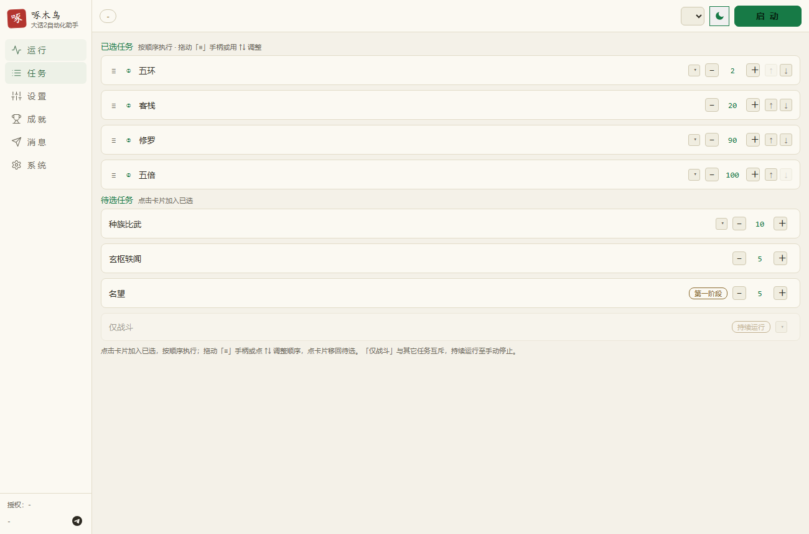

<div align="center">

# 🪶 啄木鸟

**大话西游2经典版 · 日常任务自动化助手**

五环 · 客栈 · 修罗 · 五倍 · 玄枢轶闻 · 名望 —— 点一下，整晚不用管。

[](https://github.com/OPC-UNI/dhxy_ascript/releases) [](https://github.com/OPC-UNI/dhxy_ascript/actions/workflows/ci.yml) [](#运行要求) [](#-快速开始) [](#-许可证) [](https://t.me/zhuomuniaonew_channel)

[快速开始](#-快速开始) · [功能一览](#-功能一览) · [界面预览](#-界面预览) · [Telegram](#-telegram-频道与消息服务) · [文档导航](#-文档导航) · [路线图](#-路线图)

</div>

---

## 📖 项目简介

啄木鸟是一款面向《大话西游2经典版》的 Windows 桌面端日常任务托管工具，基于 [AScript](https://ascript.cn) 构建。它不是「帮你点自动、帮你加血蓝」的挂机脚本，而是把**领取 → 跑图 → 战斗 → 交任务 → 回城**整条链路做成可托管的日常流程：任务按顺序执行，进度按角色持久化，队伍缺人自动补、缺人自动喊，运行期间游戏窗口无需保持前台。

> 前台模拟键鼠操作，**不读内存、不改包、不注入进程**；静默操作默认开启。

### 为什么选择啄木鸟

| 能力 | 说明 |
| --- | --- |
| **整条任务链路闭环** | 日常任务从领取到回城全程自动；每条任务次数独立设置，当天进度按角色持久化，停止 / 重启不重置。 |
| **队长能力自动化** | 自动创建队伍、按缺口补人、缺人喊话、暂离请离、检查人数与种族；领取被拒自动重回补人循环。 |
| **工程化稳定性** | 单帧复用、条带匹配、像素差分门、OCR 限频、相似界面双模板比分数——长时间挂机不误判、不乱点。 |
| **断点续做** | 任务进度、摄妖香时间、高性能坐标缓存均按角色保存，重启接着跑。 |
| **多开 / 组号** | 多游戏窗口按账号 ID 绑定；组号多 Tab 由队长带队，队员自动挂战斗 / 巫医 / 补蓝。 |
| **远程掌控** | Telegram Bot 查询状态、远程截图、启停任务、切换方案、解散队伍、退出游戏。 |

## ✨ 功能一览

### 🧭 任务托管

- **七种任务模式**：五环 / 客栈 / 修罗 / 五倍 / 种族比武 / 玄枢轶闻 / 名望。
- **顺序执行**：任务页多选并拖动排序（或 ↑↓ 调整），按顺序依次执行；运行中禁止修改选择与专属设置。
- **进度持久化**：次数与当天进度按角色保存，停止、重启、换号互不干扰。
- **名望快捷领取**：打开种族地图小地图（已在目标地图则直接打开，否则经世界地图）→ 勾选「任务」筛选 → 点击黄色任务 NPC 名（魔族 逆天魔 / 仙族 武尊神），游戏自动寻路并打开对话框，避开 NPC 模板被玩家、摊位、对话框遮挡的问题。

### ⚔️ 战斗托管

- **自动战斗**：人物与召唤兽动作、法术技能、法门可按账号配置。
- **战斗收尾**：战斗结束自动补血蓝，自动巫医 / 修理，自动抢盒子。
- **容错**：死亡自动归队；战斗失败自动重新领取。
- **仅战斗模式**：只运行战斗线程，零任务侧干预，可与其它任务互斥选择。

### 👥 队伍与组号

- **队伍管理**：自动创建队伍、按缺口自动补人、缺人自动喊话、暂离超时自动请离、战斗失败自动重领。
- **组号专用**：窗口内多 Tab 组队识别，队长带队，队员自动挂战斗 / 巫医 / 补蓝；暂离队员切 Tab 自动归队；按账号单独设置队员战斗动作；后台静默模式完整执行。
- **检查队伍**：修罗最少人数 / 必须种族、五倍固定 5 人等要求自动核对，不合格自动调整。

### 🎮 小游戏闭环

客栈拍毒虫 / 音律 / 破除封印 / 除异觉宝，玄枢钓鱼 / 机关，名望沙海迷踪 / 净化水晶丛林 / 蛟魔探秘（失败自动关面板重走）/ 魔取仙丹 / 传音石 / 星魂归位——均自动执行到结束。

### 🖥️ 控制面板与通用设置

- **运行看板**：阶段徽章、队伍摘要、任务队列、日志抽屉，双主题（水墨 / 暗色）。
- **通用设置**：静默操作（后台点击与键盘 / 文本注入）、启动清屏、摄妖香 1 小时管理、高性能模式（固定位置缓存点击）、战斗动作配置。
- **配置方案**：多套方案一键切换，支持导入 / 导出、重命名与复制，方案 = 全部设置的快照。
- **任务成就**：按角色隔离的累计轮次、战斗、运行时长与效率报表。
- **诊断页**：回程 / 领取 / 巫医 / 清屏 / 喊话等链路一键验证，问题定位到具体环节。

### 🔔 消息服务（Telegram）

侧边栏「消息」页配置 Bot Token / chat_id / 代理，一键分步验证通道。手机端可查询任务状态与日志、获取游戏窗口截图，并远程启停任务。完整指令见 [Telegram 频道与消息服务](#-telegram-频道与消息服务)。

### 🔐 授权、多开与更新

- **卡密授权**：启动与每次点「启动」前在线校验，面板显示授权状态与到期时间，支持解绑换绑。
- **多开绑定**：检测到多个游戏窗口时弹框选择，按标题中的账号 ID 记忆，游戏更新版本号变化也不失效。
- **老板键**：**F11** 任意前台窗口一键启动 / 停止任务。
- **自动更新**：每天自动检查或手动检查，下载校验 SHA-256 后覆盖升级，失败自动回滚；只替换程序文件，配置、角色数据与日志全部保留。

## 🖼️ 界面预览

| 任务页 | 设置页 |
| :---: | :---: |
|  |  |

> 截图取自内置控制面板（水墨主题）。

## 🚀 快速开始

### 运行要求

- **系统**：Windows 10 或更高版本。
- **游戏**：窗口模式运行，窗口尺寸按 **1378 × 831**（水墨主题）标定；拖动窗口边缘或用 Win + 方向键贴边改变尺寸后，坐标会失配。
- **游戏内设置**（开始前请勾选）：
  - 小地图「开启孔明灯」——跨地图寻路依赖；
  - 「飞行旗快捷传送」——可加快跑图；
  - 「点任务追踪不弹小地图」——减少界面遮挡；
  - 「切场景自动关闭小地图」——减少界面遮挡。

### 方式一：下载即用（推荐）

1. 前往 [Releases](https://github.com/OPC-UNI/dhxy_ascript/releases) 下载最新版本 zip。
2. 解压到任意目录，双击 `zhuomuniao.exe` 启动（无需安装 Python）。
3. 首次启动按提示激活授权；登录游戏角色后在面板绑定窗口。
4. 在「任务」页勾选任务、设置次数，点顶栏「启动」。

### 方式二：源码运行

```bash
git clone https://github.com/OPC-UNI/dhxy_ascript.git
cd dhxy_ascript
python -m venv .venv
.venv\Scripts\activate
pip install -r requirements.txt
python main.py
```

> 首次启动会按提示激活授权；游戏窗口无需保持前台（静默操作默认开启）。若在通用设置中关闭静默操作，需保持游戏前台，并避免长时间切换窗口。

### 首次使用流程

1. **激活授权**——按启动引导输入卡密。
2. **绑定窗口**——多开时选择目标游戏窗口，后续按账号 ID 自动记忆。
3. **选择任务**——「任务」页点击卡片加入已选区，拖动「≡」手柄或用 ↑↓ 调整顺序，按需展开专属设置。
4. **启动**——点顶栏「启动」或按 **F11**；「运行」看板实时显示任务进度、战斗与日志。

## 📱 Telegram 频道与消息服务

<div align="center">


**扫码或点击链接关注官方频道**

🔗 **<https://t.me/zhuomuniaonew_channel>**

版本更新与发布通知第一时间在这里推送。

</div>

### 消息服务配置

> ⚠️ **网络前提**：Telegram 服务器在境外，国内网络无法直连，**需要自备梯子（科学上网）**。除本机已有全局代理外，还需在「消息」页填写 HTTP/HTTPS 代理（如 `http://127.0.0.1:7890`，端口按你的梯子客户端实际配置填写），否则「验证」与消息推送都会连接失败。

在侧边栏「消息」页填写 Bot Token、chat_id 与代理，点「验证」分步检查通道；启用后将主动推送任务启停 / 结束 / 异常、ERROR 告警与授权拦截消息（网络抖动自动重试）。

> 同一配置目录只允许一个实例启用消息服务；多开推荐每个实例使用独立 Bot。Token 仅显示尾 4 位；未授权的 chat_id 尝试会记录但不回复。

#### 获取 Bot Token

1. 在 Telegram 搜索 **@BotFather**（官方机器人，带认证标记）并打开对话；
2. 发送 `/newbot`，按提示输入**机器人名称**（展示名，可中文）和**用户名**（必须以 `bot` 结尾、全局唯一）；
3. 创建成功后 BotFather 返回一串 `123456789:AA...` 形式的 **Bot Token**，复制填入「消息」页「Bot Token」；
4. Token 等同密码：不要外发、不要提交到仓库；泄露后在 BotFather 发送 `/revoke` 重新生成。

#### 获取 chat_id

面板「允许的 chat_id」每行一个数字 ID：**私聊为正数，群组 / 频道为负数**（形如 `-100...`），只有列表中的会话能收到消息、下发指令。

- **私聊**：点开你的 Bot 发送 `/start`，把这条消息转发给 **@userinfobot** 即可看到自己的 ID（正数）；或浏览器打开 `https://api.telegram.org/bot<你的Token>/getUpdates`，在返回 JSON 中找 `"chat":{"id":...}`。
- **群组**：把 Bot 拉进群，在群里发送 `/start@你的机器人用户名`（或给 Bot 管理员权限后发任意消息），再用 `getUpdates` 读取该群的 `"id"`（负数）；也可以把 **@getidsbot** 拉进群直接查询。
- **频道**：在频道管理里把 Bot 设为管理员（开启「发布消息」权限），频道 ID 可通过 `getUpdates` 读取，或把频道消息转发给 @userinfobot 查询（负数）。

### Bot 指令

| 指令 | 作用 |
| --- | --- |
| `/status` | 查询任务状态 |
| `/task` | 查询当前任务与进度 |
| `/log [n]` | 获取最近 n 行日志 |
| `/capture` | 获取游戏窗口截图（支持中文关键字） |
| `/start` | 启动任务（与面板按钮同链路，含启动前授权校验） |
| `/stop` | 停止任务 |
| `/schemes` | 查看配置方案列表 |
| `/switch 名称` | 切换配置方案（任务运行中不可切换） |
| `/disband` | 解散队伍（队长解散 / 队员离开） |
| `/shout [内容]` | 喊话（不带内容时使用所选任务的喊话设置） |
| `/exitgame` | 退出游戏（二次确认：停任务 → 解散 / 离开队伍 → 关闭客户端；组号多 Tab 逐个退出；游戏未启动时直接回复，不进入二次确认） |

## 📚 文档导航

| 文档 | 内容 |
| --- | --- |
| [docs/features.md](docs/features.md) | 功能详解、实测标定与边界条件 |
| [docs/architecture.md](docs/architecture.md) | 系统架构、模块分层、任务分支、生命周期 |
| [docs/performance.md](docs/performance.md) | 性能规则、热路径实测数据与轮询校准 |
| [docs/conventions.md](docs/conventions.md) | 目录归属、分层依赖与重构纪律 |
| [docs/user-data-layout.md](docs/user-data-layout.md) | 角色数据目录（`data/<角色ID>/`）设计 |
| [docs/auto-update-design.md](docs/auto-update-design.md) | 自动更新链路设计 |
| [docs/task-stats-design.md](docs/task-stats-design.md) | 任务成就报表设计 |
| [docs/ui-redesign.md](docs/ui-redesign.md) | 控制面板重设计提案与实施记录 |

## 🏗️ 项目结构

```text
dhxy2/
├─ main.py                  # 程序入口：启动流程、任务子进程调度
├─ src/
│  ├─ core/                 # 配置 / 角色数据 / 日志 / 设置，无设备与 GUI 依赖
│  ├─ device/               # 感知与执行：battle / map / task_tracker / dialog_common / team / tab_group
│  ├─ workflows/            # 跨任务业务流：follow（共享任务跟踪引擎）等
│  ├─ minigames/            # 小游戏闭环
│  ├─ tasks/                # 任务编排（五环 / 客栈 / 修罗 / 五倍 / 玄枢 / 名望……）
│  └─ app/                  # 控制面板 / 进程管理 / 更新 / 热键 / 消息服务
├─ res/                     # 界面 HTML 与图片模板
├─ docs/                    # 架构、性能、约定与设计文档
├─ scripts/                 # 打包 / 清单 / 发布工具
└─ tests/                   # 单元测试（含导入规则强制校验）
```

**分层原则**：任务只编排，能力下沉到工具模块；任务模块之间零 import；通用模块不依赖任务与 UI。规则由 `tests/test_import_rules.py` 强制执行，详见 [docs/conventions.md](docs/conventions.md)。

## 🗺️ 路线图

按优先级排列，完成后移入「功能一览」；已实现项的完整明细见 [docs/features.md](docs/features.md)。

| 优先级 | 功能 | 状态 |
| --- | --- | --- |
| P1 | 任务卡死检测与自愈（长时间无进度自动重启 + 通知） | 规划中 |
| P1 | 掉线检测（登录 Tab 监控，掉线暂停 / 通知） | 规划中 |
| P1 | 战斗动作「捕捉 / 逃跑」按钮模板与执行 | 规划中 |
| P1 | 组队申请处理（同意 / 拒绝列表 + 申请入队） | 规划中 |
| P1 | 客栈小游戏整链实机确认（拍毒虫 / 音律 / 破除封印 / 对话框模板门控） | 进行中 |
| P2 | 定时任务（设定时间自动启动 / 停止） | 规划中 |
| P2 | 任务成就报表实机验证 | 进行中 |
| P3 | 名望任务其余种族与执行流程补充 | 进行中 |
| P3 | 分辨率 / DPI 适配（当前按 1378 × 831 实测标定） | 规划中 |
| P3 | 无快捷寻路模式（禁用飞行旗 / 孔明灯，一律步行寻路） | 规划中 |

## 🛠️ 开发与构建

- **版本号唯一来源**：[src/__init__.py](src/__init__.py) 的 `__version__`；发版打 `v*` tag，CI 自动把 tag 版本号烙进构建产物。新增功能上线须同步更新 README 功能列表。
- **测试**：`python -m pytest tests/ -m "not slow"`；OCR 引擎烟测等慢测试用 `python -m pytest tests/ -m slow`。CI 每次 push / PR 自动运行。
- **exe 打包**：GitHub Actions（[.github/workflows/build-exe.yml](.github/workflows/build-exe.yml)）手动触发或 `v*` tag 自动构建；zip = exe + res + pylibs，numpy / onnxruntime 随 pylibs 分发。
- **发布流水线**：推送 `v*` tag → CI 单元测试门禁（复用 [ci.yml](.github/workflows/ci.yml)，不通过不构建）→ 构建并发布 GitHub Release / OSS → 成功后调用独立的 [notify-telegram.yml](.github/workflows/notify-telegram.yml) 把新版本与更新日志推送到 Telegram 频道（可复用工作流；不附下载链接，统一引导面板「检查更新」升级）；CI 或构建失败即停止，通知失败不影响已发布版本。
- **发布通知配置**：仓库 Secrets 配置 `TELEGRAM_BOT_TOKEN`（@BotFather 获取）与 `TELEGRAM_CHAT_ID`（频道 ID 为负数，机器人需设为频道管理员，可通过转发频道消息给 @userinfobot 或 `getUpdates` 获取）。未配置时构建照常发布，通知步骤打印警告后跳过。
- **发版**：打 `v*` tag 时 CI 拆包（app / pylibs / 完整包）、生成并校验 `update.json`、上传阿里云 OSS；Secrets 需 `OSS_ACCESS_KEY_ID` / `OSS_ACCESS_KEY_SECRET`。设计见 [docs/auto-update-design.md](docs/auto-update-design.md)。
- **日志**：双写工程目录 `logs/`（按日期）；排查任务问题先用诊断页按钮逐链路确认。
- **代码规范**：提交前过 `tests/test_import_rules.py`；任务间禁止相互 import，通用能力下沉到 `bag` / `map` / `task_tracker` / `dialog_common` / `app_utils` 等工具模块。

## ❓ 常见问题

<details>
<summary><b>会封号吗？</b></summary>

任何第三方辅助工具都存在账号风险，本工具不承诺「绝对防封」。本工具采用前台模拟键鼠（不读内存、不改包、不注入进程），点击节奏含拟人化设计，属于风险较低的一类；仍建议先用小号观察。

</details>

<details>
<summary><b>需要会写脚本吗？</b></summary>

不需要。面板开关即配置，任务页点选即可启动；高级设置里的每个链路都提供一键验证按钮，出问题可以自己定位到具体环节。

</details>

<details>
<summary><b>电脑配置要求高吗？</b></summary>

普通 Windows 10+ 即可。工具内置单帧复用、条带模板匹配、OCR 像素差分跳过等优化，任务进程常驻 CPU 约 2 核。

</details>

<details>
<summary><b>游戏需要全屏吗？</b></summary>

需要窗口模式，并按 1378 × 831 标定尺寸运行；全屏或改变窗口尺寸会导致坐标失配。

</details>

<details>
<summary><b>支持多开吗？</b></summary>

支持。多游戏窗口按标题中的账号 ID 绑定；组号场景下多 Tab 由队长带队，队员自动跟随战斗、巫医与补蓝，后台静默模式同样完整执行。

</details>

## ⚠️ 免责声明

- 本项目仅供**学习交流与个人游戏辅助**使用，请遵守游戏用户协议及当地法律法规。
- 使用任何第三方辅助工具均有账号风险，作者不对封号、数据损失或其它后果承担责任。
- 本项目不提供读写游戏内存、修改客户端、注入进程等能力，全部操作通过前台模拟键鼠完成。

## 📄 许可证

本项目基于 **MIT License** 发布，详见 [LICENSE](LICENSE)。
