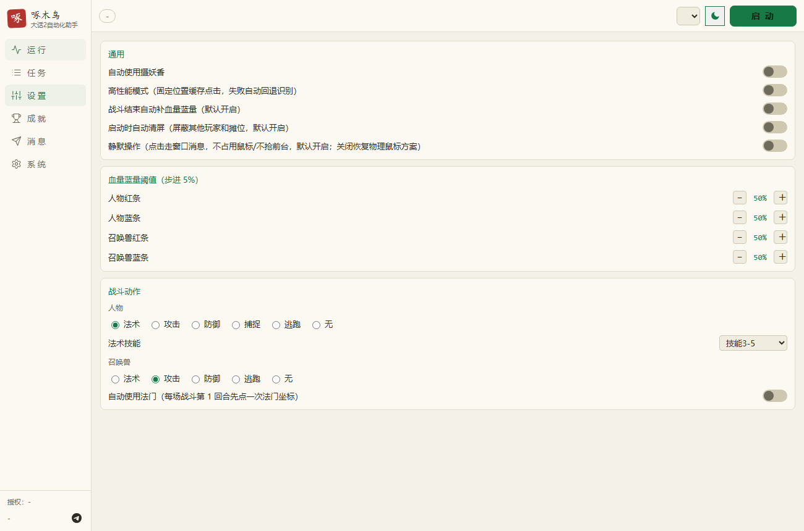

<div align="center">

# 🪶 啄木鸟

**大话西游2经典版 · 日常任务自动化助手**

五环 · 客栈 · 修罗 · 五倍 · 玄枢轶闻 · 名望 · 300环 —— 点一下，整晚不用管。

[](https://github.com/OPC-UNI/dhxy_ascript/releases) [](https://github.com/OPC-UNI/dhxy_ascript/actions/workflows/ci.yml) [](#运行要求) [](#-快速开始) [](#-许可证) [](https://t.me/zhuomuniaonew_channel)

[快速开始](#-快速开始) · [功能一览](#-功能一览) · [界面预览](#-界面预览) · [Telegram](#-telegram-频道与消息服务) · [文档导航](#-文档导航) · [路线图](#-路线图)

</div>

---

## 📖 项目简介

啄木鸟是一款面向《大话西游2经典版》的 Windows 桌面端日常任务托管工具，基于 [AScript](https://ascript.cn) 构建。它不是「帮你点自动、帮你加血蓝」的挂机脚本，而是把**领取 → 跑图 → 战斗 → 交任务 → 回城**整条链路做成可托管的日常流程：任务按顺序执行，进度按角色持久化，队伍缺人自动补、缺人自动喊，运行期间游戏窗口无需保持前台。

> 前台模拟键鼠操作，**不读内存、不改包、不注入进程**；静默操作默认开启。

### 为什么选择啄木鸟

| 能力 | 说明 |
| --- | --- |
| **整条任务链路闭环** | 日常任务从领取到回城全程自动；每条任务次数独立设置，当天进度按角色持久化，停止 / 重启不重置。 |
| **队长能力自动化** | 自动创建队伍、按缺口补人、缺人喊话、暂离请离、检查人数与种族；领取被拒自动重回补人循环。 |
| **工程化稳定性** | 单帧复用、条带匹配、像素差分门、OCR 限频、相似界面双模板比分数——长时间挂机不误判、不乱点。 |
| **断点续做** | 任务进度、摄妖香时间、高性能坐标缓存均按角色保存，重启接着跑。 |
| **多窗口 / 组号** | 自动枚举游戏主窗口为顶部窗口 Tab，点击即切换该角色的全部视图；每个窗口按自己的角色方案并行跑不同任务；组号多 Tab 由队长带队，队员自动挂战斗 / 巫医 / 补蓝。 |
| **远程掌控** | Telegram Bot 查询状态、远程截图、启停任务、切换方案、解散队伍、退出游戏。 |

## ✨ 功能一览

### 🧭 任务托管

- **八种任务模式**：五环 / 客栈 / 修罗 / 五倍 / 种族比武 / 玄枢轶闻 / 名望 / 300环。
- **顺序执行**：任务页多选并拖动排序（或 ↑↓ 调整），按顺序依次执行；运行中禁止修改选择与专属设置。
- **任务结束自清理**（2026-11-28）：每个任务正常结束（含次数达到上限直接返回）后，自动清理本任务遗留的对话框/奇遇弹窗/小地图/世界地图/物品栏，再启动下一任务——避免残留界面遮住下一任务的领取按钮（实机：10 次客栈后接修罗，残留奇遇弹窗挡住灵兽村领取按钮导致领取失败）；带绿字选项的对话框不自动选择（防错选取消/接取任务），战斗中跳过，清理失败只告警不阻断队列。
- **进度持久化**：次数与当天进度按角色保存，停止、重启、换号互不干扰。
- **五环领取冷却自动顺延**：领取五环时出现「距下次领取5环任务还差 X 分钟」提示（昨天与今天的领取时间间隔），自动记录冷却截止（含 60 秒安全余量，按角色持久化、重启仍生效），方案中的其他任务先执行；任一任务完成后冷却结束即优先回到五环，其余任务都做完仍未到点则在云游大师处等待到点领取；剩余超过 2 小时时本轮跳过、记录保留（稍后重跑直接生效）。
- **300环（江湖历练）**（2026-11-26）：Alt+Q 打开任务栏「日常活动」页，滚动查找「江湖历练任务」分组并读详情——追踪面板有「当前环名[江湖历练任务]」（实机「见多识广[江湖历练任务]」）= 运行中、直接跟踪；列表只有「历练征程」子行且详情有「目前环数」/「暂停」= 暂停、去萧举人点续跑；列表相同但详情无环数/暂停= 无任务、去萧举人点领取。领取与续跑都走洛阳小地图——勾选底部「普通」筛选显示 NPC 绿字，点击萧举人（洛阳 434,142 附近）后立即取消「普通」筛选，到达后自动弹出萧举人对话框；领取点「踏上周游之路，寻找百兽契约录失佚篇章」，续跑点「吃饱喝足，我要继续周游江湖，修复灵缘！」。萧举人对话框没有标准对话框边框，用 NPC 立绘模板判定在场后再 OCR 选项；**拼图类（固定 4×4，2026-11-26 实机验证）**：开始前截取完整目标地图作参考图，点「准备好了」后把 16 块逐个与参考图做模板匹配得到目标格（中心按钮遮挡的格用可见带补全），再按选择排序生成交换序列（点 A→点 B），完成后点「完成」并点二次确认「确定」；超时/失败点「放弃」后由跟随链路重新点追踪寻路重开（不需重接）。**挖宝类（2026-11-26）**：追踪「到白骨山（237，26）藏宝处」（地图/坐标可变）→ 点击追踪自动寻路 → 到达目标 ±8 格后打开背包-任务储物格右键「挖宝锄头」触发挖掘。**答题类（千古一题，2026-11-27 实机）**：赵大「千古三题」诗句接龙（白字给出上一句 + 4 个绿字选项），内置 700+ 诗句（上一句→下一句，独立维护在 core/poem_bank.py，可复用）自动点正确选项；未收录（含 OCR 严重误读）按用户规则随机点一个绿色选项，三题后长对话由剧情兜底推进。**天下无贼（2026-11-27 实机，两种类型）**：追踪链接到 NPC 后对话点「毛贼！休想逃！」，进入后才区分类型——**竞技场型**：浮空岛 48 秒敲怪（江湖大盗 +6 / 强盗 +4 / 强盗僵尸 +5，避开小可爱 -3 / 老人 -5，130 分通关）：背景差分圈候选 + 去背景 sprite 颜色直方图分类（28 张实机参考色样），点得越快出怪越快；**战斗型（大型鞭炮，2026-11-27 实机验证）**：开战赠送 10 个大型爆竹，一回合两阶段（右侧竖栏 8 按钮=人物、4 按钮=召唤兽）：人物点「道具」开背包→右键爆竹→左键点怪躯干，召唤兽点「防御」；两排 × 5 列固定格子，爆炸为十字（目标 + 同排左右 + 另一排同列），一步倒/两步倒/三步倒需 1/2/3 次命中且本回合死亡下回合消失；按名字标签 OCR 得到 HP 网格后用求解器给出最少回合投掷序列（全 1 型 3 回合、含两步倒 4 回合、含三步倒 5 回合），顶部红色倒计时出现即可操作窗口；进战斗先取消上一场常规战斗挂上的自动战斗（自动会抢在投爆竹前提交行动），背包跨场景记住上次储物格、爆竹所在格未命中时按储物格列逐格切换重查。两种类型失败后都自动重走追踪链接重挑战，通关后任务推进下一环。**画符（灵心巧手，2026-11-27 实机验证；符文配方库 2026-11-28）**：蝴蝶妹妹「制符」窗口，左纸模板符文 → **优先匹配符文配方库**（`res/huafu_runes.json` + `res/img/huafu_rune_*.png`：左侧符纸墨迹掩码 IoU 识别，同符文逐像素一致；命中后按该符文实机验证过的固定笔顺/路径回放，一张符文一条配方、新增互不影响，当前内置 6 张：2 笔细喙分叉符、3 笔「横竖捺」符、2 笔撇+折符、4 笔「石」字形（口按 U 形外框+上横拆分，标准三笔不过）、3 笔「而」字形（左侧闭环按环形一笔最后画，撇/竖拆分不过）、4 笔双钩+双竖符）——未收录才退回骨架推断（长笔画粗端起笔、点尖端起笔；通过判定看笔顺方向，描形相同但反向不过；静默拖拽；画得快线细、画得慢线粗）→ 点完成；窗口关闭即成功；同一窗口只画 1 次（实机点「重画」后符文不换、第二次与第一次完全相同，重画无收益），不通过即点窗口右上角 X 关闭，再重走任务追踪重新开始（重开会随机换一个符文，2026-11-27 用户规则+实机验证）。**捕捉类（贵人相助，2026-11-27 实机）**：追踪「到五指山抓回出逃的召唤兽宝宝（猴宝宝、蟾宫兔宝宝或者赭炎宝宝）并将其带回给主人」→ 点追踪链接自动寻路到目标地图 → 到达后降落（飞行驭器）→ 右键点地面走动催发暗雷遭遇 → 战斗由任务侧注入的捕捉计划（`battle.set_battle_plan`）执行：第 1 回合点「捕捉」按钮并点选宝宝（名字标签上方身体点，任选一只，捕捉一次必定成功）、召唤兽「防御」保宝宝，第 2 回合人物「逃跑」+ 召唤兽「防御」（逃跑选完仍须召唤兽出手）；退出战斗后追踪变为「找到乌鸡国国王交还召唤兽宝宝。」，交还由跟踪链路完成。给与类在选物前额外核对面板底部 NPC 行（如「NPC：黑熊精」）与任务目标一致，防止给错对象；物品按统一物品目录（device/items.py）的图标模板定位、悬停读名确认。类别型给与（2026-11-27 实机「找到属性13的炼妖石…并给予梅花仙」「找到一个9-12属性的炼妖石…并将其交给乌鸡国御林军」）：文案只写类别与属性（定值或区间）时按目录登记的同类候选逐储物格批量定位（给与面板一次只显示一个储物格，未命中自动按储物格列切换重扫，切格前逐次复核面板在场），图标模板只定位候选格——同款不同属性（+8/+9）模板会互相命中，属性以悬停提示框属性行（「抗水 +9.0%」）复核达标后才点给与，任一候选成功即停；新增候选物品只需在物品目录登记模板。等级类别型给与（2026-11-27 实机「找到一个1级或2级宝宝装备…交给村长」）：庄子/粗布衣/木筝等宝宝装备按目录登记（category=宝宝装备、attr_value=装备等级），悬停提示框「等级：N级」行复核落在任务要求等级区间才给与，任一候选成功即停。给与类有两种面板：旧版（储物格列 + 给与按钮，图标定位后悬停读物品名选物）与新版「请从两种物品任选一种给予」（2026-11-27 实机「找到一个千年魂石(40点雅誉)或天书残卷一或二(3点雅誉)，并将其交给梅花仙」）——新版面板上半部列出本次可交物品与雅誉、下半部物品格只列可交项（5 列 × 2 行可翻页），点物品格图标选中（该格红框 + 「待给予物品」框显示，点已选中的物品不会取消选择），复核待给予框后再点「确定」给与（未点确定不会给出去）。任务追踪内容会结构化（任务名称 / 所需物品 / 雅誉值，如 [千年魂石(40雅誉)、天书残卷一(3雅誉)、天书残卷二(3雅誉)]）并按 300环设置「给与物品高雅誉值优先」排序——默认开启：先试千年魂石 40；关闭则低雅誉值优先：先试天书残卷 3。旧版面板按同一顺序逐件尝试，未登记物品最后走全格悬停兜底。追踪面板行尾被截断（如「…并将其交给」）时不做 NPC 交叉核对，以给与面板「NPC：」行为准。**庭院灵气打造（2026-11-27 实机）**：给与环需要可在聚灵台打造的物品时（灵宝类前缀，或物品目录标 craftable 的忆梦符等，如实机「找到一个灵宝天威印…交给莽汉」「找到一个属性13的忆梦符…交给饲马小仙」），在点追踪链接前先去庭院打造——长安 (165,125) 点「管家」→ 选「送我回自己的庭院」→ 回庭院后小地图坐标走到聚灵台 (112,47) → 点聚灵台选「我要打造物品」（同时记录「聚灵台的灵气储存量」与「每小时回灵」）→ 打造面板点金色虚线圈物品（所需灵气 0→3000）→ 点「打造」→ 二次确认「确定」→ 等下方「打造物品」进度标志/进度条消失即完成；面板提示「你已经打造过需要的任务品了！」视为已拥有，直接继续给与。打造完成后回到跟随链路点追踪链接去给与 NPC。**四锁四色钥匙开锁（妙趣横生变体，2026-11-27 实机验证）**：NPC 阿合奇阿洪对话框点「解开这奇锁！」弹出开锁面板（剩余开锁次数 10、四色钥匙金/红/银/绿、可重复选择）——按 Mastermind 规则自动求解：点钥匙放入 4 个锁槽（逐把确认落位 + 颜色复核）→ 点「开锁」→ 读记录行两个计数徽章（绿点=全对[颜色和位置都对]、橙点=半对[只有颜色对]）→ 信息量最优选下一猜，256 种密码最坏 4 次提交即可解开（实机一局即验证通过：金红银绿 1/2 → 金金红红 0/3 → 金金金银 1/2 → 银红金金命中）。次数不足时点面板右上角 X 关窗，再重走任务追踪链接重开面板（用户规则：仅限一次），重开按面板现存记录继续。任务重启后带着已有记录接管时按行序号 + 钥匙颜色重建历史，记录不可完整重建时按剩余次数从头求解。其余环类型（旋转等）按实机遇到逐个接入。任务追踪面板标题为「当前环任务名[江湖历练任务]」（实机「见多识广[江湖历练任务]」，目前环数 1/300），该标题消失 = 本轮结束，按任务次数设置继续判定领取/续跑。
- **客栈掌柜查找兜底**（2026-11-28）：交付类任务（谢礼/密信交给掌柜）结束后人物正好站在掌柜位置上，身体把掌柜模板挡住（实测 0.571/0.607 低于阈值 0.75），原有兜底点击离人物太近不产生位移，下一轮领取会直接判「未找到掌柜」终止任务。现在未找到掌柜时按「奇遇/对话框遮挡清理 → 兜底点击 → 点远处空地走开拉开重扫」重试（走开后实测 0.923/0.980 命中，走位期间逐帧重扫命中即返回）；步点避开客栈出口（实测点到左下出口会走到洛阳城），走位意外离开客栈时自动重新寻路再试。
- **名望快捷领取**：打开种族地图小地图（已在目标地图则直接打开，否则经世界地图）→ 勾选「任务」筛选 → 点击黄色任务 NPC 名（魔族 逆天魔 / 仙族 武尊神），游戏自动寻路并打开对话框，避开 NPC 模板被玩家、摊位、对话框遮挡的问题。
- **名望任务刷新**：任务栏没有已支持的任务时自动逐卡刷新（每角色每天最多 3 次），刷新后重新识别并领取；刷新用尽仍无已支持任务时当天不再空跑（下次任务启动直接跳过）。
- **任务栏读取与降魔任务识别**：Alt+Q 开关任务栏；按「任务列表 / 任务详情」标题条模板动态定位两栏（面板可拖动，栏宽由模板宽度给出）；识别「降魔任务」分组行首图标的折叠状态并自动展开，选中分组下第一个任务后 OCR 任务详情、输出「任务目的」全文，并识别任务类型——击杀类输出地图/坐标/目标（如四圣庄 163,105 神通魔尊；含奎星归位/奎木狼：目标名紧邻括号地图坐标、无击杀动词，如 火云戈壁 134,12 奎木狼）、黄袍怪多轮类（智斗黄袍，如平顶山 302,22 愤怒的黄袍怪）、显形镜类输出 A/B 两坐标与显形镜道具模板、暗雷/锁妖网类标记需重新领取（2026-11-23 实机验证；奎星归位 2026-11-25）。**修罗任务查询**（诊断-修罗链路「查询修罗任务（任务栏识别）」按钮，2026-11-26）：打开任务栏 → 展开「常规玩法」分组 → 按任务名选中「修罗任务」（同组还可能有山河名望等其他子任务）→ 读任务目的并识别后关闭任务栏，只识别不寻路；「前往凤巢六层(84,55)处消灭修罗。」→ 击杀任务 / 凤巢六层 / (84,55) / 修罗，**修罗恒为单杀**（轮次 1），层级图地名整名保留（不被归一成「凤巢」），「任务提示」段（玩法说明）不参与识别返回。
- **五倍兼容无快捷寻路**（五倍设置，默认开启）：领取成功后任务追踪面板没有降魔任务时，自动 Alt+Q 打开任务栏读取当前降魔任务并手动寻路——击杀（含「奎星归位」奎木狼，同样是杀一次）/黄袍按识别出的地图坐标寻路，到达后按白龙马任务模板多候选点击开打（多候选处理与显形镜一致）；到达后找不到任务模板（目标点在地图边缘时游戏不渲染该小牌，用户 2026-11-24 确认）→ Alt+A 隐藏界面复查 → 仍无则按任务栏已知的完整目标名（如智慧魔尊 / 黄袍怪 / 奎木狼，显形镜腿用白龙马）OCR 世界区 NPC 名字、点击名字上方开打（与修罗同款兜底）；**特殊地图**（有描边锚点模型的莲花洞/波月洞/火云洞/金兜洞）在模板未出现时先按任务栏坐标反查屏幕点直接点击（用户 2026-11-24：名字被其他名字叠绘挡住时 OCR 读不出；反查要读 HUD 坐标，放在 Alt+A 之前，点击点为坐标屏幕点上方 25px 的角色本体）；击杀类每轮 1 次、黄袍按任务文案「最多N轮」（实测 5 轮），次数没杀完时直接复用上次命中的模板点继续杀；黄袍打满上限（通常 5 轮）后直接返程，不再读任务栏确认；显形镜任务依次去 A、B 两点并从背包-任务储物格右键使用显形镜；暗雷/锁妖网直接下一轮重新领取替换；「领取奎木狼任务」开关关闭时，奎木狼任务（含奎星归位）手动链路同样不寻路、下一轮重领替换。**特殊地图**（如莲花洞：世界地图无标签、进入后无小地图）经父地图入口进入——先按平顶山 (102,42) 入口坐标寻路，走近光圈自动进洞；未自动进门时走场景地图「普通」筛选 + 入口 NPC（金角大王/银角大王）兜底。进洞后按 HUD 坐标**右键步行**：用**角色屏幕位置**算出当前视窗内可见的世界范围，每次只点**路线上屏幕内最远的途经点**（中间点跳过，视线随人物滚动自动推进），不会把点击钳到屏幕边缘；角色屏幕位置优先用**描边锚点模型**（人工描边时顺带记录「世界坐标→角色屏幕位置」，导航时按 HUD 坐标就近查表，人多读不到名字也不受影响），其次 OCR 角色名字标签（可见时）/HUD 坐标+屏幕映射反算；路线用描边边界内的**栅格 A***（几何最短路，绕开两臂间空洞和洞内传送光圈）；**没有首步停顿**：一上来就连续右击（约 0.5s，行走可打断）；接近目标时停稳复核，误差超 ±3 按最终误差修正点击偏置再补一步；相机位移逐帧跟踪实时更新屏幕↔世界映射（单次位移超过区域半幅会混叠，已限幅；不可测时用锚点模型按当前站位重标定），并用上次结束视图热启动免探针，±3 格即可。异形地图支持**人工描边建图**：`scripts/trace_special_map.py` 只读坐标记录玩家实走轨迹（同时按 1s 间隔记录角色屏幕锚点样品），`scripts/build_special_map_route.py` 生成该图边界（boundary）、可选捷径折线（trace）与角色屏幕锚点模型（self_anchor）。语义：**描边以内都可走、以外不可走**——边界内直接直线导航（客户端自动绕障），边界外自动落到最近可走边界点，不会点空洞（2026-11-23 实机验证）。其他异形图同样用 `--map` 录制即可。**多分区地图**（波月洞：同一坐标平面分 A/B 两区、区之间靠洞口传送连接）：`--zones` 按传送跳变自动拆分每区边界与传送触发点/落点，导航先走到本区洞口触发点，等待场景切换后在目标区继续步行，区内其他洞口自动避让；落点无稳态锚点样品时（建图标记 `land_recalibrate`，波月洞只有 B→A 的 A 落点）先用角色名字标签 OCR、失败再强制探针重标定（转场期样品偏差可达 150px+；A→B 的 B 落点锚点正常仍用模型，避免探针绕路）；洞内 HUD 地名比较容忍 1 个 OCR 错字（2026-11-24 数据与机制）。**世界地图坐标导航开图后统一取消小地图「普通」筛选**（用户 2026-11-24：五倍手动寻路与所有任务一致，勾选时入口点附近的 NPC 名会吃掉点击；仅特殊地图 NPC 入口兜底临时勾选，需绿字入口名）。有任务追踪时流程完全不变（2026-11-23 接入/实机验证）。另有**「强制手动寻路」测试开关**（五倍设置-队长执行，默认关闭，与修罗同款）：即使有任务追踪（快捷寻路可用）也忽略追踪、打开任务栏识别降魔任务走手动链路，开启时视同打开兼容无快捷寻路；手动链路无法推进的暗雷/锁妖网与手动回合失败会在下一轮重新领取替换（防每轮手动回合空转）。**预走路**（2026-11-24，与修罗同款限制，按任务模式识别：修罗=灵兽村 / 五倍=宝象国）：领取后任务栏确认任务需执行（击杀/黄袍/显形镜，暗雷/锁妖网不导航不预走），首次手动寻路开图前先开小地图点**宝象国 75,135**让角色先走，把开图/面板等待时间用于赶路；本轮有自动巫医时**整轮不预走**（巫医、修理行程与随后手动寻路都不预走，每轮结束复位）；起点不在宝象国、目标同图、无标定/换算越界/小地图打不开自动跳过，不影响导航。

### ⚔️ 战斗托管

- **自动战斗**：人物与召唤兽动作、法术技能、法门可按账号配置。
- **阶段判定**：按右侧操作栏 8 按钮=人物、4 按钮=召唤兽先行确认当前阶段——人物动作提交后只等 4 按钮栏出现再做召唤兽操作，操作栏仍是人物阶段时不误点（8/4 模板仅用于判阶段，动作仍走原按钮/坐标）。
- **战斗收尾**：战斗结束自动补血蓝，自动巫医 / 修理，自动抢盒子。
- **容错**：死亡自动归队；战斗失败自动重新领取。
- **修罗兼容无快捷寻路**（默认开启）：快捷寻路被消耗、领取后没有任务追踪时自动改走手动寻路——
  从领取对话框解析目的地，手动开图寻路，到达后识别任务标记逐个点击开打（被面板遮挡时 Alt+A 兜底）；
  目标点在地图边缘时游戏不渲染任务小牌，Alt+A 后仍无标记则 OCR 世界区名字「xx修罗」、点击名字上方开打；特殊地图（莲花洞/波月洞/火云洞/金兜洞）标记找不到时先按领取对话框坐标反查屏幕点直接点击（名字被叠绘遮挡时的兜底，点击点为坐标屏幕点上方 25px 的角色本体）；
  有任务追踪时原流程完全不变。另有「强制手动寻路」测试开关（默认关）：即使有快捷寻路也走手动链路。
- **仅战斗模式**：只运行战斗线程，零任务侧干预，可与其它任务互斥选择。

### 👥 队伍与组号

- **队伍管理**：自动创建队伍、按缺口自动补人、缺人自动喊话、暂离超时自动请离、战斗失败自动重领。
- **组号专用**：窗口内多 Tab 组队识别，队长带队，队员自动挂战斗 / 巫医 / 补蓝；暂离队员切 Tab 自动归队；按账号单独设置队员战斗动作；后台静默模式完整执行。
- **检查队伍**：修罗最少人数 / 必须种族、五倍固定 5 人等要求自动核对，不合格自动调整。

### 🎮 小游戏闭环

客栈拍毒虫 / 音律 / 破除封印（失败自动重走，上限 5 次）/ 除异觉宝，玄枢钓鱼（失败自动关面板重走，上限 5 次）/ 机关，名望沙海迷踪 / 净化水晶丛林 / 蛟魔探秘（失败自动关面板重走）/ 魔取仙丹 / 传音石 / 星魂归位——均自动执行到结束。

### 🖥️ 控制面板与通用设置

- **运行（窗口为轴）**：顶部窗口 Tab 全局切换当前角色，运行页只显示该窗口的状态（阶段 / 任务 / 今日进度 / 本窗口启停 / 方案）、任务队列与日志（任务队列不显示滚动条；日志为底部浮层，展开/收起带过渡动画且不挤压队列，拖拽顶部手柄可调高、双击复位并记忆高度）；顶栏「全部启动 / 全部停止」；Tab 条右侧「管理」进入多开管理，只做绑定勾选（整行点击即切换）；启动/方案/配置分别在顶栏、窗口状态卡和任务页；不做跨窗口进度合计。双主题（水墨 / 暗色，系统页切换）。
- **通用设置**：静默操作（后台点击与键盘 / 文本注入；**多窗口并行必须开启**）、启动清屏、摄妖香 1 小时管理、高性能模式（固定位置缓存点击 + 快捷键：背包 Alt+E、世界地图 Alt+2、小地图 Alt+1，失败自动回退识别）、战斗动作配置。
- **配置方案**：多套方案一键切换，支持导入 / 导出、重命名与复制，方案 = 全部设置的快照（快速切换在运行页当前窗口卡，管理在「设置」页顶部）。
- **任务成就**：按角色隔离的累计轮次、战斗、运行时长与效率报表。
- **诊断页**：回程 / 领取 / 巫医 / 清屏 / 喊话等链路一键验证，问题定位到具体环节；**地图导航**：选择地图（含龙窟/凤巢/大雁塔各层与特殊地图莲花洞）并输入坐标后自动开图、悬停读坐标标定、校验后点图寻路并验证到达（2026-11-20 实机验证）；特殊地图（莲花洞）世界地图无标签、洞内无小地图，按父地图入口（平顶山 102,42）寻路自动进洞，未进门时走场景地图「普通」筛选 + 入口 NPC（金角大王/银角大王）兜底；进洞后按 HUD 坐标右键走到目标（±3 格；角色屏幕锚点 = 名字标签/HUD+映射，点击只取角色附近 ≤320px 的方向点，相机位移跟踪 + 上次视图热启动）；异形图可人工描边建图（`scripts/trace_special_map.py` + `scripts/build_special_map_route.py`），描边以内直接直线导航、以外落到最近可走边界点、不点空洞坐标；世界地图坐标导航开图后统一取消「普通」筛选防误点 NPC（2026-11-24 规则，五倍手动寻路与所有任务一致）；特殊地图 NPC 入口兜底临时勾选以显示绿字入口名；普通图与龙窟/凤巢/大雁塔 1-6 层共 70 项内置标定表（`res/map_nav_affines.json`）免采样，悬停校验的偏差修正会写回会话缓存（同图后续导航一次命中），**2026-11-22 起再写角色持久化 `data/<角色>/map_nav_affines.json`——进程重启后也直接命中**（内置表原点对地图窗口几何敏感：宝象国窗口漂移后首瞄差 5 格，持久化后重启不再多付一次修正悬停；窗口再漂仍由悬停校验自动修正并刷新）；**层块页标题模板内置表 `res/map_nav_layer_tiles.json`**（2026-11-25 实机抓取龙窟/凤巢 14 层）：进层点层块前用模板匹配（~10ms）+ 小区域 OCR 读回层名确认（~60-90ms/层，取代整页 OCR ~0.5-0.9s），OCR 吞字（实测「凤巢一层/二层」读成「凤巢层」）按「基础名+层、不含其它层序号、模板分数 ≥0.97」放行，否则回退整页 OCR；运行期新学/刷新的模板写 `data/map_nav_layer_tiles.json`（全角色共享，优先于内置表），损坏/布局变化自动回退重学；宝象国标定已按实测重新采集（2026-11-21，首瞄回读误差 ≤1 格）；大雁塔入口的寻路链接按黄带文本读回校验（防点成别的层）、开图后再核对窗口竖排地图名。另有**任务点位导航（坐标化测试）**（2026-11-21）：预置 21 个任务点位（领取/巫医/修理/五环/沙都/客栈/种族/玄枢/预走路），逐个一键导航验证坐标化落点，逐行显示到达位置与误差，共用「中断寻路」；「客栈入口」按钮走真实客栈链路（自动点路标/飞行旗菜单的「快送我去」，按客栈内 24,7 附近判到达）。通用设置新增**「任务点位坐标化寻路」开关**（默认开启）：领取/巫医/修理/五环/沙都/客栈/玄枢/种族等任务点位按地图坐标开图标定点击，与固定像素点位同点位；关闭即回滚原固定像素寻路（无需回退版本）。小地图「任务」筛选开图后统一取消勾选（仅名望需要勾选点黄色任务名，避免任务点名与地形点击点重叠误触寻路/对话框）。客栈入口坐标点击可能命中玩家飞行旗：对话框目的地含「洛阳客栈」时自动点确认，传送到客栈内 24,7 附近同样判到达；种族比武领取 NPC 点击前增加名称 OCR 分选「昊天」（名称只用于选对模板候选，点击点取模板中心；同模型侍卫/姿态变化不误点、不点偏）；预走路仅在修罗任务启用。**五倍（降魔任务）识别与寻路（模拟）**：五倍（降魔任务）链路内每类任务一个按钮（三藏逢魔/智斗黄袍/宝象迷情/殿前献艺），自动打开任务栏识别当前五倍任务，关闭任务栏后按识别出的地图/坐标手动寻路（显形镜依次 A、B；暗雷只识别并提示需重新领取），到达即算完成（2026-11-23）。**边缘目标查找**（模板与坐标组，只读不点击）：单帧先查五倍/修罗任务小牌模板（打印最高分、阈值与全部候选点），都未命中（目标点在地图边缘时游戏不渲染该小牌）再 OCR 世界区名字并汇总一行打印识别到的名字（不逐行刷屏正式日志），附修罗「xx修罗」后缀候选；可选填目标 X/Y（任务栏/领取对话框的坐标）时同时打印特殊地图坐标反查屏幕点（与任务兜底同一模型，名字被叠绘挡住时的落点）——站在手动寻路到达的边缘目标旁点一次即可核对名字兜底（2026-11-24）。诊断按窗口放行：本窗口任务未启动即可诊断，多开时其他窗口运行不影响。

### 🔔 消息服务（Telegram）

侧边栏「消息」页配置 Bot Token / chat_id / 代理，一键分步验证通道。手机端可查询任务状态与日志、获取游戏窗口截图，并远程启停任务。完整指令见 [Telegram 频道与消息服务](#-telegram-频道与消息服务)。

### 🔐 授权、多开与更新

- **卡密授权（设备绑定）**：卡密首次激活绑定当前电脑（Windows MachineGuid 指纹，不采集 MAC/IP），启动与每次点「启动」前本地 RSA-PSS 验签 + 在线心跳，运行期间按服务端心跳间隔（默认 300 秒）持续上报在线状态；面板显示授权状态、到期时间与设备码；未激活时显示激活页并锁定导航，但激活页仍可检查/应用更新（避免旧版本问题卡死）；换机需作者在后台释放旧设备。
- **多窗口 Tab**：自动枚举所有游戏主窗口并按角色 ID 记忆勾选；每个窗口用自己角色的方案并行执行，窗口间完全独立。新窗口默认不勾选；同一角色只允许一个运行窗口（跨安装实例同样互斥）；窗口关闭 / 最小化只停该窗口，其余继续；关闭的窗口即从多开管理与 Tab 移除，重开自动重新出现（勾选记忆保留）。窗口 Tab 顺序固定，运行/选中不跳位。已登录窗口会在画面弹出「其它玩家已经用这个账号登录，请立即退出游戏」顶号对话框时按未登录处理（启动前实时复检，禁止启动）；正在运行的该窗口任务检测到顶号后记 ERROR 并立即中止（复用任务已有的对话区 OCR 判定，不额外截图）。
- **单实例 / 多安装**：同一安装目录只允许运行一个「啄木鸟」实例（第二次启动会唤起已有面板）；不同安装目录可以并行，各自独立配置、角色数据、日志与授权。
- **老板键**：**F11 只停不起**（一键停止全部窗口任务）；启动一律从面板操作。
- **自动更新**：每天自动检查或手动检查，下载校验 SHA-256 后覆盖升级，失败自动回滚；只替换程序文件，配置、角色数据与日志全部保留。

## 🖼️ 界面预览

| 任务页 | 设置页 |
| :---: | :---: |
|  |  |

> 截图取自内置控制面板（水墨主题）。

## 🚀 快速开始

### 运行要求

- **系统**：Windows 10 或更高版本。
- **游戏**：窗口模式运行，窗口尺寸按 **1378 × 831**（水墨主题）标定；拖动窗口边缘或用 Win + 方向键贴边改变尺寸后，坐标会失配。
- **游戏内设置**（开始前请勾选）：
  - 小地图「开启孔明灯」——跨地图寻路依赖；
  - 「飞行旗快捷传送」——可加快跑图；
  - 「点任务追踪不弹小地图」——减少界面遮挡；
  - 「切场景自动关闭小地图」——减少界面遮挡。

### 方式一：下载即用（推荐）

1. 前往 [Releases](https://github.com/OPC-UNI/dhxy_ascript/releases) 下载最新版本 zip。
2. 解压到任意目录，双击 `zhuomuniao.exe` 启动（无需安装 Python）。
3. 首次启动按提示激活授权；登录游戏角色后会自动出现在「多开管理」，第一个窗口自动勾选并进入顶部 Tab（其余窗口勾选后进入 Tab 条）。
4. 在「任务」页勾选任务、设置次数，点顶栏「启动」。

### 方式二：源码运行

```bash
git clone https://github.com/OPC-UNI/dhxy_ascript.git
cd dhxy_ascript
python -m venv .venv
.venv\Scripts\activate
pip install -r requirements.txt
python main.py
```

> 首次启动会按提示激活授权；游戏窗口无需保持前台（静默操作默认开启）。**多窗口并行必须开启静默操作**；关闭静默时只允许单窗口运行，且需保持游戏前台、避免长时间切换窗口。

### 首次使用流程

1. **激活授权**——首次打开面板会自动显示激活页，输入卡密激活后左侧导航解锁并进入运行看板。
2. **加入多开**——已勾选、当前选中或运行中的窗口会出现在顶部 Tab（≥2 个时显示）；新窗口默认不勾选，点顶栏「多开 N 窗口」/ Tab 条右侧图标进入多开管理勾选它，勾选后立即出现在 Tab 条。每个窗口读取自己角色的方案与设置。
3. **选择任务**——「任务」页点击卡片加入已选区，拖动「≡」手柄或用 ↑↓ 调整顺序，按需展开专属设置；切换窗口 Tab 即切换正在编辑的角色。
4. **启动**——点顶栏「全部启动」（或状态卡「启动本窗口」逐窗口启动）；运行页实时显示该窗口的阶段、进度与日志。**F11 只停不起**。

## 📱 Telegram 频道与消息服务

<div align="center">


**扫码或点击链接关注官方频道**

🔗 **<https://t.me/zhuomuniaonew_channel>**

版本更新与发布通知第一时间在这里推送。

</div>

### 消息服务配置

> ⚠️ **网络前提**：Telegram 服务器在境外，国内网络无法直连，**需要自备梯子（科学上网）**。除本机已有全局代理外，还需在「消息」页填写 HTTP/HTTPS 代理（如 `http://127.0.0.1:7890`，端口按你的梯子客户端实际配置填写），否则「验证」与消息推送都会连接失败。

在侧边栏「消息」页填写 Bot Token、chat_id 与代理，点「验证」分步检查通道；启用后将主动推送任务启停 / 结束 / 异常、ERROR 告警与授权拦截消息（网络抖动自动重试）。

> 同一安装目录只允许运行一个实例（不同安装目录可并行，各自启用消息服务）；多开推荐每个实例使用独立 Bot。Token 仅显示尾 4 位；未授权的 chat_id 尝试会记录但不回复。

#### 获取 Bot Token

1. 在 Telegram 搜索 **@BotFather**（官方机器人，带认证标记）并打开对话；
2. 发送 `/newbot`，按提示输入**机器人名称**（展示名，可中文）和**用户名**（必须以 `bot` 结尾、全局唯一）；
3. 创建成功后 BotFather 返回一串 `123456789:AA...` 形式的 **Bot Token**，复制填入「消息」页「Bot Token」；
4. Token 等同密码：不要外发、不要提交到仓库；泄露后在 BotFather 发送 `/revoke` 重新生成。

#### 获取 chat_id

面板「允许的 chat_id」每行一个数字 ID：**私聊为正数，群组 / 频道为负数**（形如 `-100...`），只有列表中的会话能收到消息、下发指令。

- **私聊**：点开你的 Bot 发送 `/start`，把这条消息转发给 **@userinfobot** 即可看到自己的 ID（正数）；或浏览器打开 `https://api.telegram.org/bot<你的Token>/getUpdates`，在返回 JSON 中找 `"chat":{"id":...}`。
- **群组**：把 Bot 拉进群，在群里发送 `/start@你的机器人用户名`（或给 Bot 管理员权限后发任意消息），再用 `getUpdates` 读取该群的 `"id"`（负数）；也可以把 **@getidsbot** 拉进群直接查询。
- **频道**：在频道管理里把 Bot 设为管理员（开启「发布消息」权限），频道 ID 可通过 `getUpdates` 读取，或把频道消息转发给 @userinfobot 查询（负数）。

### Bot 指令

| 指令 | 作用 |
| --- | --- |
| `/status [all]` | 查询任务状态（all=全部窗口概览） |
| `/task [all]` | 查询当前任务与进度（all=逐窗口合计） |
| `/window [序号/角色名/ID]` | 查看/切换当前窗口（后续指令作用于该窗口） |
| `/log [n]` | 获取最近 n 行日志 |
| `/capture` | 获取游戏窗口截图（支持中文关键字） |
| `/start [all]` | 启动选中窗口 / 全部已勾选窗口（含启动前授权校验） |
| `/stop [all]` | 停止选中窗口 / 全部窗口任务 |
| `/schemes` | 查看配置方案列表 |
| `/switch 名称` | 切换配置方案（任务运行中不可切换） |
| `/disband` | 解散队伍（队长解散 / 队员离开） |
| `/shout [内容]` | 喊话（不带内容时使用所选任务的喊话设置） |
| `/exitgame` | 退出游戏（二次确认：停任务 → 解散 / 离开队伍 → 关闭客户端；组号多 Tab 逐个退出；游戏未启动时直接回复，不进入二次确认） |

> `/status`、`/task`、`/start`、`/stop` 加 `all`（或「全部」「所有」）作用于全部窗口；不加时只作用于顶部 Tab 当前选中的窗口，可用 `/window 序号` 或 `/window 角色名` 远程切换这个「当前窗口」，后续 `/shout`、`/start` 等指令随之切换。

## 📚 文档导航

| 文档 | 内容 |
| --- | --- |
| [docs/features.md](docs/features.md) | 功能详解、实测标定与边界条件 |
| [docs/architecture.md](docs/architecture.md) | 系统架构、模块分层、任务分支、生命周期 |
| [docs/performance.md](docs/performance.md) | 性能规则、热路径实测数据与轮询校准 |
| [docs/conventions.md](docs/conventions.md) | 目录归属、分层依赖与重构纪律 |
| [docs/user-data-layout.md](docs/user-data-layout.md) | 角色数据目录（`data/<角色ID>/`）设计 |
| [docs/multi-window.md](docs/multi-window.md) | 多窗口多方案执行设计（窗口 Tab / 多开管理 / 目标注入 / 每角色日志 / 互斥） |
| [docs/auto-update-design.md](docs/auto-update-design.md) | 自动更新链路设计 |
| [docs/task-stats-design.md](docs/task-stats-design.md) | 任务成就报表设计 |
| [docs/ui-redesign.md](docs/ui-redesign.md) | 控制面板重设计提案与实施记录 |

## 🏗️ 项目结构

```text
dhxy2/
├─ main.py                  # 程序入口：启动流程、任务子进程调度
├─ src/
│  ├─ core/                 # 配置 / 角色数据 / 日志 / 设置，无设备与 GUI 依赖
│  ├─ device/               # 感知与执行：battle / map / task_tracker / dialog_common / team / tab_group
│  ├─ workflows/            # 跨任务业务流：follow（共享任务跟踪引擎）等
│  ├─ minigames/            # 小游戏闭环
│  ├─ tasks/                # 任务编排（五环 / 客栈 / 修罗 / 五倍 / 玄枢 / 名望……）
│  └─ app/                  # 控制面板 / 多窗口 Tab / 进程管理 / 更新 / 热键 / 消息服务
├─ res/                     # 界面 HTML 与图片模板
├─ docs/                    # 架构、性能、约定与设计文档
├─ scripts/                 # 打包 / 清单 / 发布工具
└─ tests/                   # 单元测试（含导入规则强制校验）
```

**分层原则**：任务只编排，能力下沉到工具模块；任务模块之间零 import；通用模块不依赖任务与 UI。规则由 `tests/test_import_rules.py` 强制执行，详见 [docs/conventions.md](docs/conventions.md)。

## 🗺️ 路线图

按优先级排列，完成后移入「功能一览」；已实现项的完整明细见 [docs/features.md](docs/features.md)。

| 优先级 | 功能 | 状态 |
| --- | --- | --- |
| P1 | 任务卡死检测与自愈（长时间无进度自动重启 + 通知） | 规划中 |
| P1 | 掉线检测（登录 Tab 监控，掉线暂停 / 通知） | 规划中 |
| P1 | 组队申请处理（同意 / 拒绝列表 + 申请入队） | 规划中 |
| P1 | 客栈小游戏整链实机确认（拍毒虫 / 音律 / 破除封印 / 对话框模板门控） | 进行中 |
| P2 | 定时任务（设定时间自动启动 / 停止） | 规划中 |
| P2 | 任务成就报表实机验证 | 进行中 |
| P3 | 名望任务其余种族与执行流程补充 | 进行中 |
| P3 | 分辨率 / DPI 适配（当前按 1378 × 831 实测标定） | 规划中 |
| P3 | 无快捷寻路模式（禁用飞行旗 / 孔明灯，一律步行寻路） | 规划中 |

## 🛠️ 开发与构建

- **版本号唯一来源**：[src/__init__.py](src/__init__.py) 的 `__version__`；发版打 `v*` tag，CI 自动把 tag 版本号烙进构建产物。新增功能上线须同步更新 README 功能列表。
- **测试**：`python -m pytest tests/ -m "not slow"`；OCR 引擎烟测等慢测试用 `python -m pytest tests/ -m slow`。CI 每次 push / PR 自动运行。
- **exe 打包**：GitHub Actions（[.github/workflows/build-exe.yml](.github/workflows/build-exe.yml)）手动触发或 `v*` tag 自动构建；zip = exe + res + pylibs，numpy / onnxruntime 随 pylibs 分发。
- **发布流水线**：推送 `v*` tag → CI 单元测试门禁（复用 [ci.yml](.github/workflows/ci.yml)，不通过不构建）→ **更新日志预览**（独立 `changelog` job 按发版规则生成并写入 Actions 运行页 Job Summary，可在耗时构建前核对；手动 `workflow_dispatch` 同样生成「上一 tag..HEAD」草稿预览）→ 构建并发布 GitHub Release / OSS → 成功后调用独立的 [notify-telegram.yml](.github/workflows/notify-telegram.yml) 把新版本与更新日志推送到 Telegram 频道（可复用工作流；不附下载链接，统一引导面板「检查更新」升级）；CI 或构建失败即停止，通知失败不影响已发布版本。**更新日志按提交类型自动分类**：`feat` → 新增功能、`fix` → 问题修复、其余 → 变更与优化，纯内部提交（docs/test/ci/build/style/chore 与版本号 bump）不展示；可用 `changelog/<tag>.md` 人工覆盖（见 [scripts/make_release_notes.py](scripts/make_release_notes.py)）。
- **发布通知配置**：仓库 Secrets 配置 `TELEGRAM_BOT_TOKEN`（@BotFather 获取）与 `TELEGRAM_CHAT_ID`（频道 ID 为负数，机器人需设为频道管理员，可通过转发频道消息给 @userinfobot 或 `getUpdates` 获取）。未配置时构建照常发布，通知步骤打印警告后跳过。
- **发版**：打 `v*` tag 时 CI 拆包（app / pylibs / 完整包）、生成并校验 `update.json`、上传阿里云 OSS；Secrets 需 `OSS_ACCESS_KEY_ID` / `OSS_ACCESS_KEY_SECRET`。设计见 [docs/auto-update-design.md](docs/auto-update-design.md)。
- **日志**：工程目录 `logs/<日期>/` 下按角色分文件（`<角色ID>.log`）并保留 `system.log`；排查任务问题先用诊断页按钮逐链路确认。特殊地图人工描边的过程文件（轨迹 JSONL / 汇总 / 边界核对图 / 全图 PNG）统一放在 `map_trace/`（本地工作数据，不入库），不再混在 `logs/`。
- **代码规范**：提交前过 `tests/test_import_rules.py`；任务间禁止相互 import，通用能力下沉到 `bag` / `map` / `task_tracker` / `dialog_common` / `app_utils` 等工具模块。

## ❓ 常见问题

<details>
<summary><b>会封号吗？</b></summary>

任何第三方辅助工具都存在账号风险，本工具不承诺「绝对防封」。本工具采用前台模拟键鼠（不读内存、不改包、不注入进程），点击节奏含拟人化设计，属于风险较低的一类；仍建议先用小号观察。

</details>

<details>
<summary><b>需要会写脚本吗？</b></summary>

不需要。面板开关即配置，任务页点选即可启动；高级设置里的每个链路都提供一键验证按钮，出问题可以自己定位到具体环节。

</details>

<details>
<summary><b>电脑配置要求高吗？</b></summary>

普通 Windows 10+ 即可。工具内置单帧复用、条带模板匹配、OCR 像素差分跳过等优化，任务进程常驻 CPU 约 2 核。

</details>

<details>
<summary><b>游戏需要全屏吗？</b></summary>

需要窗口模式，并按 1378 × 831 标定尺寸运行；全屏或改变窗口尺寸会导致坐标失配。

</details>

<details>
<summary><b>支持多开吗？</b></summary>

支持。所有游戏主窗口会自动出现在「多开管理」里，按角色 ID 记忆勾选；勾选后进入顶部窗口 Tab（当前选中/运行中的窗口即使反选也保留 Tab）。每个窗口跑自己角色的方案，可同时执行不同任务。当前打开的窗口才会出现在多开管理与 Tab 里，窗口关闭即移除、重开自动重新出现（勾选记忆保留）。多窗口并行要求开启静默操作；同一角色只允许一个运行窗口，同一安装目录只允许一个程序实例。组号场景下多 Tab 仍由队长带队，队员自动跟随战斗、巫医与补蓝。

</details>

## ⚠️ 免责声明

- 本项目仅供**学习交流与个人游戏辅助**使用，请遵守游戏用户协议及当地法律法规。
- 使用任何第三方辅助工具均有账号风险，作者不对封号、数据损失或其它后果承担责任。
- 本项目不提供读写游戏内存、修改客户端、注入进程等能力，全部操作通过前台模拟键鼠完成。

## 📄 许可证

本项目基于 **MIT License** 发布，详见 [LICENSE](LICENSE)。
