# 啄木鸟 · 大话西游2经典版自动化助手 — 技术架构

> 面向：参与维护、排障和扩展本项目的工程师。
> 代码基线：`src/` 当前主干（v2.9.5 之后）。图中节点名与函数名一致，便于直接定位。
> 约定：实线为主路径，边上的文字为分支条件；带「」的文案是游戏内 OCR 原文。
> 阅读顺序：图 1 看进程与模块边界 → 图 4-1 ~ 4-6 看各任务分支 → 图 5/6 看共享引擎 → 图 7 看组队与组号。
> 渲染：GitHub 直接渲染；VSCode 需安装 Mermaid 预览插件（如 Markdown Preview Mermaid Support）。

---

## 0. 架构速览

| 维度 | 设计 |
|---|---|
| 进程模型 | **主进程**（pywebview GUI / 控制平面）+ **任务子进程**（spawn，daemon）+ **悬浮层绘制子进程**（subprocess，独立进程） |
| 线程模型 | 主进程：GUI 主线程、TaskManager 日志监听、窗口看护、老板键消息泵、托盘、Runtime 驻留、OCR 预热；任务子进程：`task_start` daemon 线程、`battle.watch_loop` 战斗线程、摄妖香空闲兜底线程、debug_overlay 监督线程 |
| 停止模型 | **杀进程是唯一可靠的全线程清理方式**：`stop_event → join 3s → terminate → join 1s → kill`（业务循环无协作式停止标志） |
| 任务编排 | 面板勾选任务 → 按顺序逐个进入 `_run_task_mode`；每个任务循环自然结束后切下一个，全部结束任务进程退出 |
| 感知 | Win32 窗口截图（不激活）→ PIL 帧（OCR / 绿字）或 BGR 帧（模板匹配）；RapidOCR 三种引擎（全帧 / 区域 / 2x 放大）+ OpenCV 模板匹配 |
| 执行 | 物理鼠标（拟人化，全局 `RLock` 串行）或静默消息通道（`WM_MOUSEMOVE/LBUTTONDOWN/UP`，不移动鼠标、不抢前台）；键盘同理区分物理 / `WM_SYSKEY` / `WM_CHAR` |
| 持久化 | `config.json`（KeyValue：软件全局设置 + 窗口绑定）、`data/<角色ID>/`（settings/schemes/state/task_stats/high_perf，按角色隔离）、`debug_overlay_state.json`（看板/悬浮层心跳）、`logs/日期.log`；详见 docs/user-data-layout.md |
| 硬约束 | 每轮询只截一帧；模板热路径必须用 ROI 条带；OCR 与绿字判定必须用 PIL(RGB) 帧；跟随超时不计战斗时间；关键时序常量是实测校准资产 |

---

## 1. 系统全景架构图

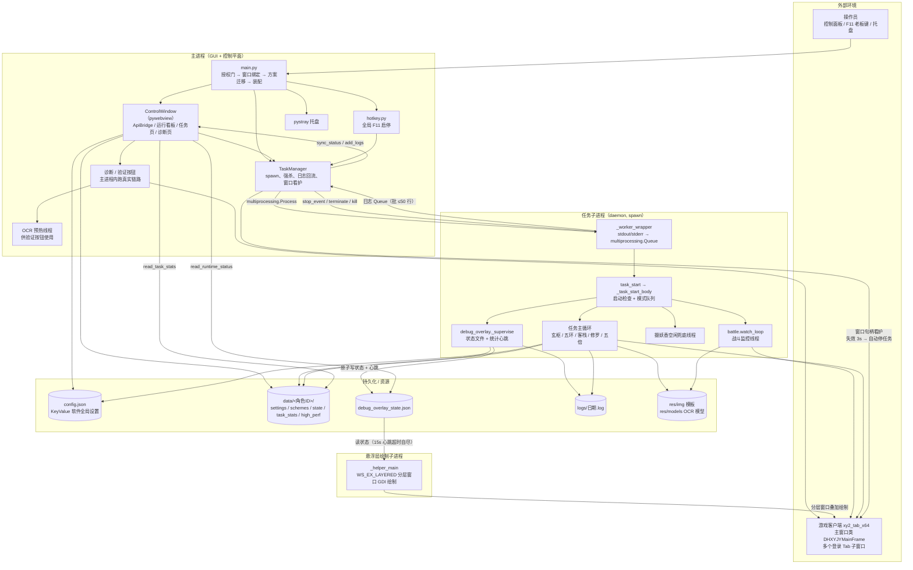

### 1.1 进程 / 线程职责

| 单元 | 职责 | 关键约束 |
|---|---|---|
| 主进程 | 唯一 GUI、配置管理、授权门、窗口绑定、任务启停、诊断验证 | 主线程必须跑 `webview.start()`；授权窗口 / 绑定弹窗各独占一次消息循环后清理 `webview.windows` |
| TaskManager | 子进程生命周期、日志队列回流、窗口看护、启停互斥 | 停止采用四级升级；旧 monitor 不得覆盖新任务状态 |
| 任务子进程 | 启动检查、战斗线程、任务主循环、摄妖香续用、悬浮层监督 | 所有循环可被强杀；`task_start` 顶层兜底 `UserAbort` 与未捕获异常落盘 |
| 悬浮层子进程 | 读取状态文件绘制游戏窗口上的任务信息 | 父进程死 15s 后 `os._exit`；崩溃由监督线程自动重启；GDI 崩溃只丢悬浮层 |
| 更新助手 | 自动更新：等主进程退出 → 备份/覆盖 exe/res/pylibs → 重启/回滚 | 运行在 `%TEMP%` 的 exe 副本，不锁安装目录；只动白名单文件；详细设计见 `docs/auto-update-design.md` |
| 主进程验证 | 「诊断」页按钮在主进程跑真实链路（OCR 预热在此） | 与任务子进程共用 `find_main_window` 接缝；绑定 Tab 护栏 |

---

## 2. 模块分层与依赖

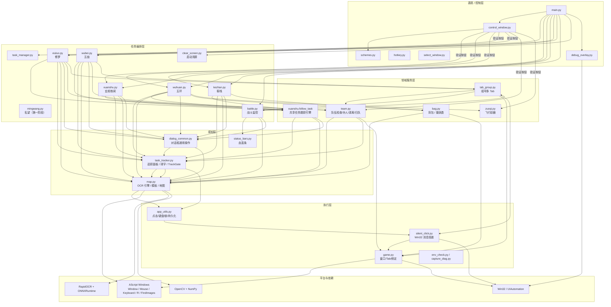

> 依赖方向：任务模块只向下依赖感知/执行层；`battle ↔ team/tab_group`、`app_utils ↔ silent_click` 存在反向调用，均通过**函数内延迟导入**打破循环依赖。

---

## 3. 启动、运行与停止生命周期

### 3.1 主进程启动时序

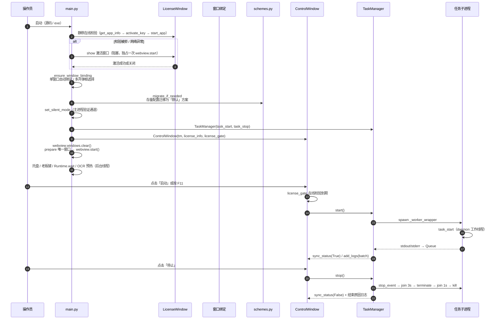

### 3.2 任务子进程启动检查

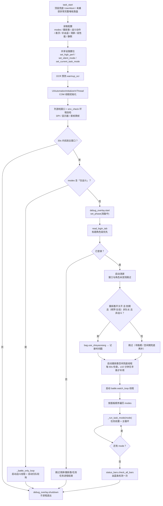

### 3.3 停止与异常收口

| 路径 | 行为 |
|---|---|
| 面板停止 / F11 | `TaskManager.stop()`：置 `stop_event` → 子进程 wrapper 在 ≤3s 内执行 `task_stop`（回收悬浮层进程）→ 未退出则 `terminate` → 再 `kill` |
| 任务自然结束 | 模式列表跑完 / 达到次数上限 / 每日上限 / 无法继续（如客栈找不到掌柜）→ `_task_start_body` 结束 → wrapper 执行 `task_stop` → monitor 收口 `exitcode` |
| 游戏窗口关闭 | `_window_watchdog` 每秒 `IsWindow(target)`，连续 3 次失效判定窗口已关闭 → 自动 `stop()` 防截图失败刷屏 |
| 用户接管鼠标 | 物理鼠标移到屏幕角落触发 fail-safe → `UserAbort`（继承 `BaseException`，穿透所有 `except Exception`）→ 顶层记 WARN 后干净中止 |
| 任务子进程异常 | `task_start` 记录完整堆栈到日志文件后重抛；monitor 输出 `exitcode` |

---

## 4. 任务分支总览

### 4.1 模式分发

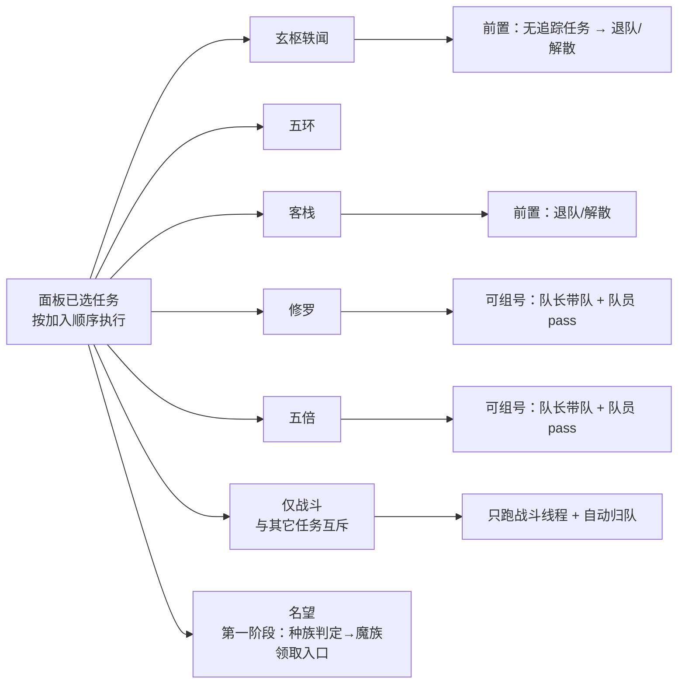

### 4.2 分支速查表（详细流程见图 4-1 ~ 4-6）

| 任务 | 阶段 | 分支条件 | 行为 |
|---|---|---|---|
| 玄枢轶闻 | 前置 | 追踪中无任务 | `team.leave_or_disband_team` 单人执行 |
| 玄枢轶闻 | 领取 | 已在洛阳 93,125 附近 | 跳过寻路，直接找领取按钮 |
| 玄枢轶闻 | 领取 | 不在洛阳 | 世界地图 → 洛阳 → 小地图点任务点 → 等待到达 |
| 玄枢轶闻 | 领取 | 领取按钮被对话框遮挡 | 点屏幕中间关闭后重试 |
| 玄枢轶闻 | 领取 | 「少侠已经完成5次任务」 | 结束任务（每日次数已满） |
| 玄枢轶闻 | 跟踪 | 追踪出现「使用监天盘」 | 火云戈壁寻路 → 点监天盘 → 探妖 → 仙药 |
| 玄枢轶闻 | 跟踪 | 出现封印提示对话框 | 关对话 → Alt+C 降落 → 按 黄→蓝→红 点机关 |
| 玄枢轶闻 | 跟踪 | 追踪出现「机关·东/南/西」 | 按 南→东→西 顺序点链接（进度键 + 下划线定位） |
| 玄枢轶闻 | 跟踪 | 出现锄遗聚宝小游戏 | 点开始 → 清红色杂气 → 主图消失结束 |
| 客栈 | 前置 | 始终 | 退队/解散单人执行 |
| 客栈 | 判定 | 追踪无任务 | 隔 2s 复核一次，防瞬时漏读 |
| 客栈 | 跟踪 | 任务要求大理寺/比武场 | 手动寻路（带 REDO_INTERVAL 节流） |
| 客栈 | 跟踪 | 追踪出现智戏成空三封印链接 | 按 风吟印→炎阳印→水镜印 顺序点链接（进度键「封印N」+ 下划线定位；三处全开文案「封印已经全部开启」，同三才） |
| 客栈 | 跟踪 | 出现「你输了/平局」 | 关对话 → 重新点任务绿字推进 |
| 客栈 | 跟踪 | 奇遇对话框 | 多选项恒点第一个 |
| 客栈 | 跟踪 | 音律小游戏入口被点击后 | 检测窗口横幅 → 辨八音演奏 15 次 |
| 客栈 | 跟踪 | 神秘宝箱 / 给与面板 | 独立处理链路 |
| 客栈 | 领取 | 每日次数已满 / 任务链结束 | 结束任务 |
| 客栈 | 领取 | 在客栈但找不到掌柜 | 终止任务 |
| 五环 | 准备 | 背包已有项链 | 跳过购买 |
| 五环 | 准备 | 背包无项链 | 布店寻路 → 降落检查 → 进店 → 买 2 件 → 购买 |
| 五环 | 领取 | 活力值不足 | 开关开：点「不差那点小钱…」继续；关：点「那可不行…」结束 |
| 五环 | 领取 | 今日两次已满 | 结束任务 |
| 五环 | 跟踪 | 提交装备对话 | 点「刚好我这里有，送你啦」→ 给与面板选项链 → 给与 |
| 五环 | 跟踪 | 单次/每日完成恭喜 | `SingleComplete` / `DailyComplete`，按对话框证据计数 |
| 五环 | 跟踪 | 任务消失但无恭喜对话框 | 8s 窗口补查；仍未命中判面板瞬时不可读、不计完成 |
| 五环 | 跟踪 | 给与面板找不到项链 | `MissingEquipment` → 结束任务 |
| 修罗 | 启动 | 组号激活但「检查队伍」关闭 | 停止任务并提示 |
| 修罗 | 启动 | 组号激活但非队长 Tab | 停止任务；确定性未组队则降级为普通非队长继续 |
| 修罗 | 启动 | 队员 Tab 未设置战斗动作 | 停止任务并提示先到组号页设置 |
| 修罗 | 每轮 | 追踪已有任务 | 直接跟踪，并记队长/已检查队伍 |
| 修罗 | 领取前 | 不在领取点 | 先判队长身份，非队长不白走寻路 |
| 修罗 | 领取前 | 缺人 | 进入监控循环：补申请人 → 重查 → 人满才领取 |
| 修罗 | 领取 | 不足 5 人确认弹窗 | 检查队伍开：拒绝 → 补人；关：拒绝并下轮重试 |
| 修罗 | 领取 | 「战斗力异常强大」（<3 人） | 关对话框 → 补人 |
| 修罗 | 领取 | 首次领取成功 | 后续轮次跳过队伍检查 |
| 修罗 | 跟踪 | 「看打！」对话 | 点绿字进战斗；若 OCR 漏检则 2x 放大兜底 |
| 修罗 | 返程 | 本轮由「看打！」进入战斗 | 开背包任务格 → 修罗回城符 → 关面板 → 走回 NPC |
| 修罗 | 非队长 | 确定性非队长 | `_keep_alive` 保持模式：只跑战斗线程 + 自动归队 |
| 五倍 | 跟踪 | 追踪任务含锁妖网 | 抛 `ReplaceTaskError` → 下一轮重新领取替换 |
| 五倍 | 跟踪 | 领取奎木狼开关关闭且任务含奎木狼 | 同上替换 |
| 五倍 | 跟踪 | 显形镜 A 处未触发对话框 | 点链接去 B 处；两处用镜失败 → 替换任务 |
| 五倍 | 跟踪 | 显形镜任务按钮候选多处 | 逐一点击，误点阻塞对话框先关闭再换候选 |
| 五倍 | 跟踪 | 黄袍怪多杀 | 每次战斗结束后重点追踪链接走下一处 |
| 五倍 | 返程前 | 黄袍怪轮次且任务仍在 | 4s 内复查，仍在则跳过返程继续跟踪 |
| 五倍 | 返程 | 本轮由「看打！」进入战斗 | 开背包任务格 → 五倍回城符 → 关面板 → 走回 NPC |
| 五倍 | 结束 | 完成任务次数上限 | 结束并记录进度 |
| 名望（第一阶段） | 启动 | 种族判定（按角色每天缓存一次） | 当天缓存直接复用；无当天缓存且需领取时：点 (1230,95) 开人物属性 → 匹配标题牌 → 标题牌右侧 120px 条带 OCR → 魔族/仙族，成功后写当天缓存（同日不再重判；角色可转种族，跨天重判；诊断重判可刷新） |
| 名望（第一阶段） | 领取 | 前往领取点（2026-11-12 去掉起飞/降落） | 直接经小地图/世界地图点目的地寻路；到达领取点不做起飞/降落（旧版 zuoqi.ensure_flying 起飞 + ensure_landed 降落已去掉）→ Alt+4 清屏 → 点 NPC |
| 名望（第一阶段） | 领取 | 魔族且不在大唐边境 | 世界地图「大唐边境」→ 小地图点 (985,384) → 等到达 477,180 |
| 名望（第一阶段） | 领取 | 已在大唐边境 | 开小地图点 (985,384) → 等到达 |
| 名望（第一阶段） | 领取 | 到达后 | 点逆天魔 → 绿字「开启山河名望志」（不用对话框门控）→ 点山河名望入口打开面板 |
| 名望（第一阶段） | 启动 | 追踪面板已有「山河名望」 | 跳过种族判定与领取，直接点击追踪绿字续跑跟踪（对齐玄枢轶闻） |
| 名望（第一阶段） | 面板领取 | 面板锚点下方 6 卡（3列×2行） | 逐卡 OCR 级别/标题 → 优先级 高级>中级>初级 + 卡片顺序选已实现任务（蛟魔复仇/沙海迷踪/蛟魔探秘/五庄封印/沙都修罗）→ 卡内点「接取」→ 按钮消失/任务进追踪面板即成功 |
| 名望（第一阶段） | 面板领取 | 无已实现任务 | 1s 复扫一次，仍无 → 结束并打印当前 6 卡级别/标题 |
| 名望（第一阶段） | 领取后 | 接取后出现对话框 | 对话框模板门控命中 → 点屏幕中间关闭（多屏复检，最多 3 次） |
| 名望（第一阶段） | 领取后 | 追踪出现「山河名望」 | 复用 xuanshu.follow_task 跟踪至任务完成（追踪面板标题条模板为门，防面板竖牌同名误判） |
| 名望（第一阶段） | 任务跟踪 | 对话「黑水河深，不如蛟魔之心。」 | 点绿色选项「逆天魔大将派我前来」（DIALOG_OPTION_MAP + extra_dialog_handler；story_known_texts 防误关） |
| 名望（第一阶段） | 沙海迷踪 | 对话「少侠准备好清理地图了吗？」→「我已经准备好了」→「开始」按钮 | armed 窗口（20s）内识别 mingwang_chenjiuditu_kaishi 点击进入「记住混沌」小游戏：地图卷轴区 363,262-1031,630 检测深黑墨团并按命中累计记录坐标（最大通道<60+面积/形状过滤，排除山体噪点）→ 底部提示含「显形」切换点击阶段 → 逐坐标点两下（第一下显形→间隔 0.2s 第二下净化；因点击被吞导致烟雾残留时 200ms 后补点）→ 中部横条「此处混沌已消散！」确认 → 循环下一批墨团，倒计时耗尽/弹窗关闭/结算文字结束（2026-11-11 实机验证通过） |
| 名望（第一阶段） | 净化水晶丛林 | 对话「糟糕，水晶丛林竟真被混沌缠上了，得赶快净化这些混沌！」→「马上净化水晶丛林上的混沌。」 | armed 窗口（20s）内识别「开始」按钮 mingwang_qingxishuijing_kaishi 点击进入战斗，战斗结束即完成 |
| 名望（第一阶段） | 蛟魔探秘 | 对话「老头子我最喜欢的，就是在这里钓鱼了~」→「请将鱼竿借我一用！」 | armed 窗口（120s/限频 1s）内识别窗口标题 mingwang_diaochushuizhongguaiwu，复用 pochufengyin 点击冲刺连点闭环（mash：在线估算每击推进量连点冲刺，到带后维持泵点击率伺服（按位置误差调节持续点击率）对抗自动回退、逼近右缘停泵，不按倒计时停手），标题消失即结束 |
| 名望（第一阶段） | 蛟魔复仇（暗雷战斗） | 追踪文案含「（暗雷战斗）」（如「请在女儿村仔细搜查」） | 点击追踪绿字由 follow 引擎完成寻路（本状态机不点链接）；解析「请在<地图>仔细搜查」目标地图，按 1s 限频识别地图位置地名（区域 OCR + 共享帧缓存），到达目标地图 → zuoqi.ensure_landed 降落（面板识别飞行状态、飞行中点「降落」，降落后关面板）→ 等待暗雷遭遇战斗（battle 线程托管，不做特殊处理）。已降落标志保持到目标地图变化/触发词连续 5 轮缺失复位（空 OCR 帧为战斗心跳不计缺失），新任务领取复位 |
| 名望（第一阶段） | 沙都修罗 | 追踪文案包含「根据三张蟠桃园残像所示位置」 | 不在蟠桃园 → 世界地图点「蟠桃园」标签 shijie_pantaoyuan 开小地图；依次点小地图 (739,588)→(126,32)、(623,476)→(66,87)、(541,428)→(27,112)、(552,310)→(33,171)、(710,393)→(111,130) 寻路到达 → 先查 NPC 本体模板 mingwang_shaduxiuluo（阈值 0.79，命中直接点模板中心）→ 未命中再世界区域 OCR 找「沙都修罗」（排除任务追踪同名文案 x&lt;400）→ 点文案上方 40px；全部路点均未找到限频重试 |
| 名望（第一阶段） | 主循环 | 完成一轮 | 回去领取下一轮，直到次数上限；启动时已有任务则跳过领取直接续跑 |
| 名望（第一阶段） | 启动 | 仙族/其他种族 | 结束并提示待补充（当前仅魔族） |
| 仅战斗 | 启动 | 已登录 | 只启动战斗线程；死亡落轮回司自动归队（默认开） |
| 仅战斗 | 启动 | 未登录 | 直接结束 |

### 4.3 图 4-1：玄枢轶闻（`xuanshu.py`）

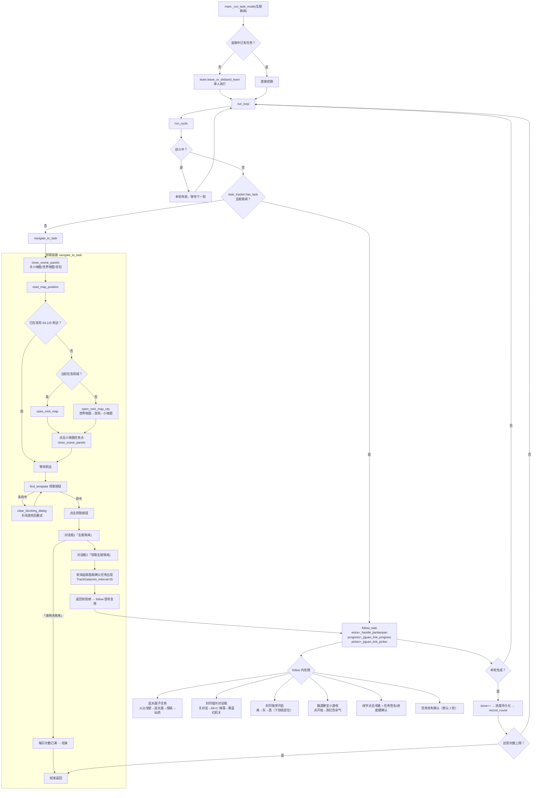

### 4.4 图 4-2：客栈（`kezhan.py`）

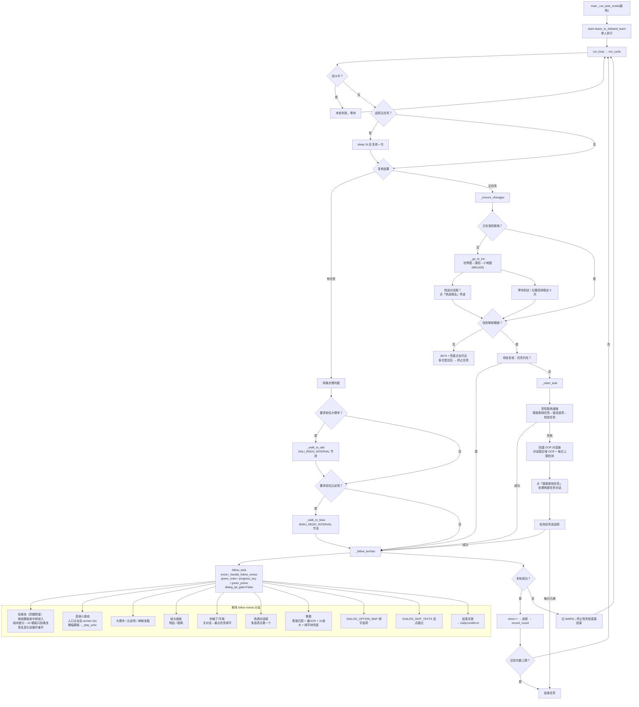

### 4.5 图 4-3：五环（`wuhuan.py`）

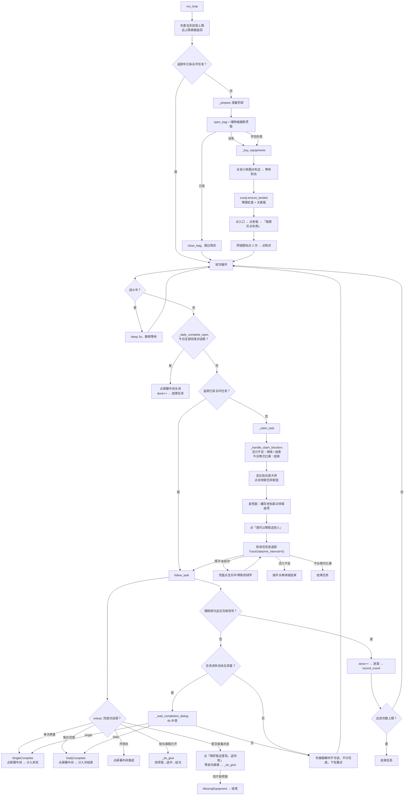

### 4.6 图 4-4：修罗（`xiuluo.py`）

```mermaid
flowchart TB
    A["run_loop"] --> A1["读取设置<br/>检查队伍 / 自动巫医间隔 / 喊话 / 自动创建"]
    A1 --> A2["启动清场<br/>申请待处理态：清空申请列表"]
    A2 --> A3["自动创建队伍：开关开且「检查队伍」开时<br/>并入首次队伍检查（组号 startup_check /<br/>单号首次领取前检查）；检查队伍关时单独执行<br/>战斗中顺延"]
    A3 --> A4{"当天进度已达上限？"}
    A4 -- 是 --> Z0["结束任务"]
    A4 -- 否 --> A5["tab_group.init_task<br/>组号开关 + 已登录 Tab ≥2"]
    A5 --> A6{"组号激活？"}
    A6 -- 否 --> L
    A6 -- 是 --> A7{"「检查队伍」开关开？"}
    A7 -- 否 --> Z1["停止任务并提示"]
    A7 -- 是 --> A8["startup_check<br/>一次开面板：队长三分类 + 成员昵称"]
    A8 --> A9{"队长判定结果"}
    A9 -- 确定性未组队 --> A10["组号降级关闭<br/>按普通非队长继续"]
    A9 -- 非队长/无法判定 --> Z2["停止任务：请在队长 Tab 启动"]
    A9 -- 队长 --> A11["startup_member_check<br/>队员动作缺失 → 停止任务"]
    A10 --> L
    A11 --> L["轮次循环"]

    L --> L1["ensure_leader_tab 护栏"]
    L1 --> L2{"战斗中？"}
    L2 -- 是 --> L3["等待战斗结束"]
    L2 -- 否 --> L4["申请清场；自动创建仅「检查队伍」关闭时顺延执行"]
    L4 --> L5{"追踪已有修罗任务？"}
    L5 -- 是 --> L6["record_leader_status(True)<br/>_team_checked=True → follow"]
    L5 -- 否 --> L7{"检查队伍开 且 首次未检查？"}
    L7 -- 是 --> L7a{"组号启动检查已读到人数？"}
    L7a -- 是 --> L7b["人数下限达标 → ready 直接领取<br/>不足 → 走位后监控补人<br/>不再为身份重开面板"]
    L7a -- 否 --> L8["读位置/帧判断是否在领取点"]
    L8 -- 不在 --> L9["_check_team_with_retry<br/>自动创建并入首次检查（同一次菜单）<br/>瞬态失败原地重查；确定性非队长 → keep_alive"]
    L8 -- 在 --> L10["跳过身份预检"]
    L7 -- 否 --> L10
    L7b --> L11
    L9 --> L11["_walk_to_claim_spot"]
    L10 --> L11
    L11 --> L12{"检查队伍开 且 首次未检查？"}
    L12 -- 是 --> L13["预检 ready：直接领取<br/>预检 wait：等 10s 进监控<br/>未预检：立即监控"]
    L13 --> L14["_monitor_team_and_fill<br/>人满返回；非队长转 keep_alive"]
    L12 -- 否 --> C
    L14 --> C["_claim_task(allow_fill=check_team)"]
    C --> C1["_click_entry_ensuring_dialog<br/>按钮/NPC 入口；无对话框则小地图重定位重试"]
    C1 --> C2["同帧点「闲来无事，要我帮忙吗」"]
    C2 --> C3{"领取弹窗"}
    C3 -- 不足5人确认 --> C4["拒绝 → 监控补人；开关关则拒绝重试"]
    C3 -- 战斗力异常强大 --> C5["关对话框 → 监控补人"]
    C3 -- 无 --> C6["校验任务进追踪<br/>TrackGate(min_interval=0) + 对话框按需 OCR"]
    C6 -- 2x 重识别命中 --> C7["成功，返回校验帧"]
    C6 -- 未命中 --> C8["小地图重走领取点后再检索一次"]
    C8 -- 仍无 --> C9["失败，下轮重试"]
    C6 --> C7
    C4 --> C7
    C5 --> C7

    L6 --> W
    C7 --> W{"自动巫医轮次？"}
    W -- 是 --> W1["取消阻塞对话框 → _auto_wuyi"]
    W -- 否 --> W2["领取后取消阻塞对话框"]
    W1 --> F
    W2 --> F["follow_task<br/>extra=_handle_fight_dialog<br/>battle_extras_tpl_gate=True"]
    F --> F1["对话开打：点「看打！」<br/>OCR 漏检 → 2x 放大重识别"]
    F1 -- 任务内容中未找到绿色文案<br/>且领取后 30s 内 --> F2["走到领取点补偿重试一次"]
    F --> G{"本轮成功？"}
    G -- 否 --> G1["记 WARN，下一轮"]
    G -- 是 --> G2{"本轮由看打进入战斗？"}
    G2 -- 是 --> G3["返程：开背包任务格→回城符→关面板→走回 NPC"]
    G2 -- 否 --> G4["不返程"]
    G3 --> H["done++ → 进度 → record_round"]
    G4 --> H
    H --> H1{"达到次数上限？"}
    H1 -- 是 --> Z["结束"]
    H1 -- 否 --> L

    L9 -.->|"确定性非队长"| K["_keep_alive 非队长保持模式"]
    K --> K1["battle.wuyi_fast_idle=True"]
    K1 --> K2["每 3s：非战斗且未 pass → maybe_rejoin"]
    K2 --> K3["落点轮回司 → 开面板→点「回归队伍」→校验离开"]
    K3 --> K4["尝试后 30s 放慢重查"]
    K4 --> K2
```

### 4.7 图 4-5：五倍（`wubei.py`）

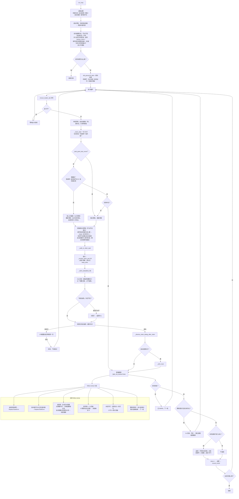

> 五倍与修罗共享 `_keep_alive`（非队长保持模式 + 自动归队）、`_monitor_team_and_fill`、`_claim_task` 的领取校验骨架、返程链路（`_open_task_box → _use_return_talisman → _close_return_panels → _return_to_npc`）与自动巫医链。

### 4.8 图 4-6：仅战斗（`main._battle_only_loop`）

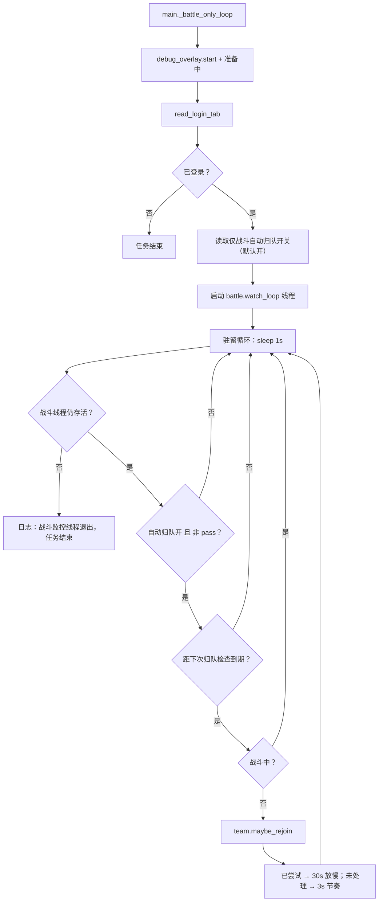

---

## 5. 共享任务跟踪引擎 `follow_task`（`xuanshu.py`）

五环 / 客栈 / 修罗 / 五倍 / 玄枢共用同一套跟踪状态机。理解它是理解全部任务分支的前提。

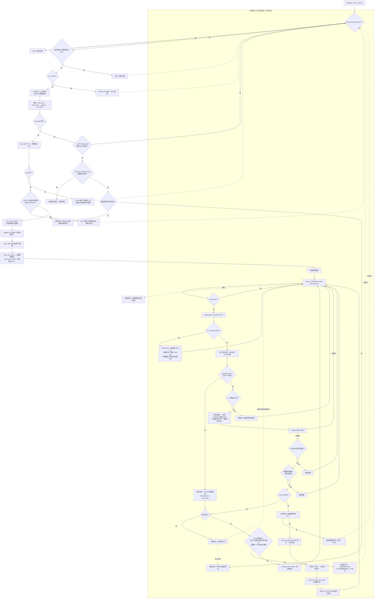

### 5.1 判定优先级与关键设计

| 优先级 | 判定 | 原因 |
|---|---|---|
| 1 | `tab_group.pass_active` 直接跳过 | 屏幕可能是队员 Tab，任何识别/点击都会作用到错误账号 |
| 2 | 组号队长 Tab 护栏 | pass 切回失败残留时不能点寻路链接 |
| 3 | `is_in_battle_frame` 前置 | 战斗 UI 遮挡追踪面板，且动画帧帧不同，门控/帧复用全部失效 |
| 4 | `extras` 优先于内置对话表 | 防止同一帧「extras 已点开打选项，内置表又点一次」的双击 |
| 5 | 任务消失确认（默认 2 轮） | 面板半透明渲染/瞬时漏读会误判完成；五倍非黄袍怪轮次可降为 1 轮；追踪面板缺席按任务结束判定（游戏无追踪任务时自动收起），判定帧查遮挡负条件（背包/地图/队伍）——标准对话框不挡追踪面板、不在遮挡名单（用户 2026-11-12 确认，完成瞬间的收尾剧情对话不阻塞判定）；战斗结束返程路径跳过遮挡检查 |
| 6 | 文本签名 + 进度键双信号 | 文字不变仅颜色变化（封印进度）也要识别为推进；单信号抖动被两轮确认过滤 |
| 7 | 变化确认同一信号 | 防止「文本抖一次 + 进度键抖一次」组合骗过确认、重复点击 |
| 8 | 寻路期摄妖香 + 组号血蓝 pass | 点击追踪链接后的寻路窗口无弹框遮挡，是背包交互/切 Tab 的安全窗口 |

**超时规则**：`FOLLOW_TIMEOUT=300s`，但战斗中时间不计入——进入战斗记 `battle_since`，首个非战斗帧把战斗耗时加回 `deadline`。这是黄袍怪多杀任务单轮含 4~5 场战斗仍能完成的必要条件。

---

## 6. 战斗监控线程（`battle.watch_loop`）

战斗线程与任务线程并行，负责：按场次调度战斗操作、战后补血蓝、巫医对话框、修罗盒子、组号队员 pass。

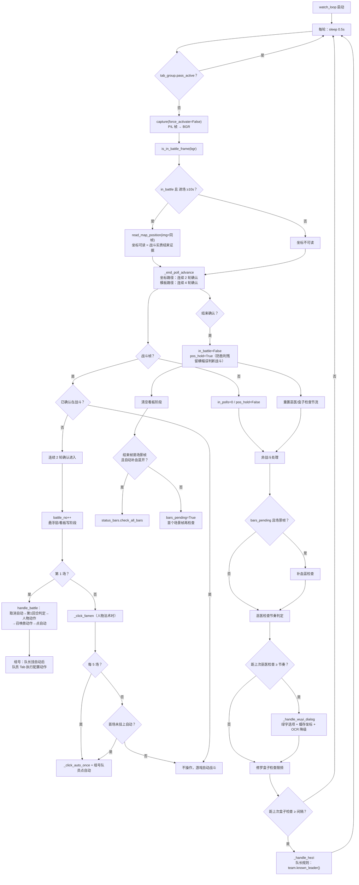

### 6.1 场次调度规则

| 场次 | 行为 |
|---|---|
| 第 1 场 | `handle_battle`：取消自动 → 判定第 1 回合 → 人物动作 → 召唤兽动作 → 点自动；组号队员按账号配置执行一次 |
| 第 6/11/16…（每 5 场） | 进场后点一次自动按钮；组号队员只点自动 |
| 其余场次 | 不操作，依赖自动战斗跨场持续 |
| 首场未挂上自动 | `pending_auto=True`，下一场进场补点一次 |
| 每场第 1 回合 | 自动使用法门（仅人物动作为法术时） |

### 6.2 战斗结束与巫医

| 机制 | 说明 |
|---|---|
| 进入确认 | 连续 2 轮战斗帧（`BATTLE_CONFIRM_POLLS=2`） |
| 模板结束确认 | 连续 4 轮非战斗帧（`0.5s × 4 = 2s`），防回合间隙误判 |
| 坐标快速结束 | 进场 ≥10s 后，地图坐标可读连续 2 轮即确认结束（覆盖胜利画面残留横幅仍匹配战斗模板的设备形态） |
| 巫医节奏 | 战后高发窗口 2s；主流程点 NPC 后预期窗口 2s；窗口外 10s 兜底；空闲场景连续空检后降级 4s |
| 巫医选项缓存 | 按（模式 + 文案）分键，禁止跨弹窗复用；点击成功即缓存坐标 |
| 盒子（修罗） | 独立限频检查，仅队长身份参与 |

---

## 7. 队伍与组号子系统

### 7.1 图 7-1：队伍检查 / 补人 / 暂离请离 / 归队（`team.py`）

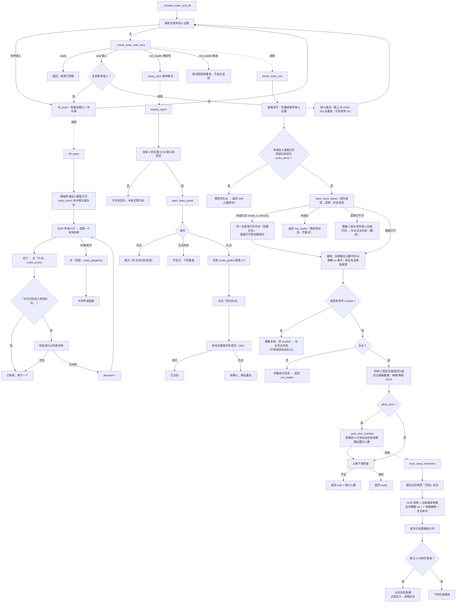

### 7.2 图 7-2：组号多 Tab（`tab_group.py`）

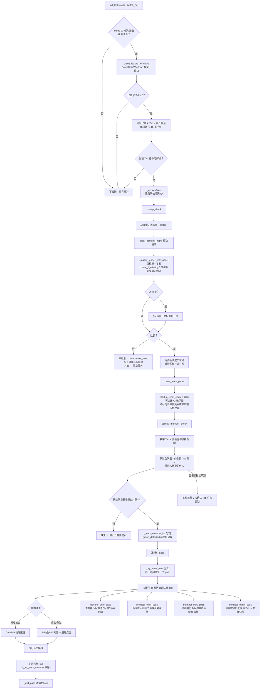

**组号结论原则**：多个 Tab 都登录 **不一定**是组号。只有「队伍检查 + Tab 标题角色名比对」确认**在队伍中**的 Tab 才算组员；不在队伍/未确认的 Tab 完全不碰。确定性未组队时降级关闭组号、按普通非队长继续，不停止任务。

---

## 8. 感知与执行基础设施

### 8.1 感知管线

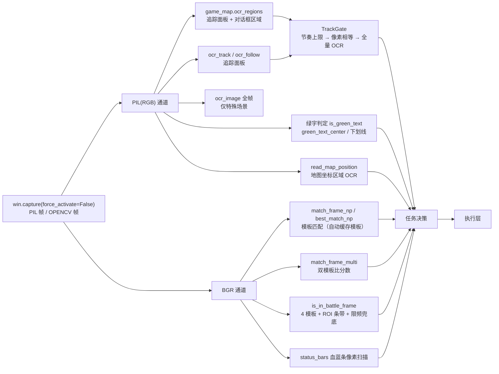

### 8.2 OCR 引擎

| 引擎 | 用途 | 参数特征 |
|---|---|---|
| 全帧引擎 `_engine` | 极少数全帧识别、任务块 2x 重识别 | `min/736`，`use_angle_cls=False` |
| 区域引擎 `_region_engine` | 追踪面板 / 对话框区域（热路径） | `max/736`，`use_angle_cls=False` |
| 2x 放大引擎 `_zoom_engine` | 对话框区 2x 裁剪（巫医/开打/答题小字） | `max/1600`，仅限放大后最长边 ≤1600 |
| 推理线程 | 全部引擎 `intra=2 / inter=1` | 禁止改回默认全核（CPU -63%，wall 持平） |

### 8.3 模板匹配与 ROI

- 模板文件：`res/img/*.png`，`map._load_template` 灰度缓存（mtime 失效）。
- 快速接口：`match_frame_np` / `best_match_np` / `match_frame_multi`（BGR 帧、阈值默认 0.8、返回匹配中心）。
- 新增检测点必须：
  1. 从真实截图标定 ROI 条带（≥50px 余量）；
  2. 带区全未命中才全帧兜底；
  3. 全帧兜底必须限频（参考 `FULL_CHECK_INTERVAL=3s`）；
  4. 相似模板互匹配必须**双模板比分数**，各自达标且更高者胜。

### 8.4 输入通道

| 操作 | 静默模式开（默认） | 静默模式关 |
|---|---|---|
| 鼠标点击 | `silent_click.send_silent_click` → 向可见 Tab 子窗口投递 `WM_MOUSEMOVE/WM_LBUTTONDOWN/UP`（或右键） | `Mouse` 物理移动 + 点击（拟人化 ±2px） |
| 鼠标移动 | 空操作（无物理悬停态） | `Mouse.mouse_move`，40~90ms |
| Alt 组合键 | `WM_SYSKEYDOWN/UP`（无需前台） | `Keyboard.key_hot`（只进前台窗口） |
| 文本输入 | `WM_CHAR` 逐字符注入 + `WM_CHAR` 回车发送 | `Keyboard.input`（中文走剪贴板粘贴）+ Enter |
| Tab 切换 | 前台：Ctrl+Tab；后台：Tab 条 UIA 矩形 + 消息点击 | Ctrl+Tab |
| 全局互斥 | 所有点击/按键序列持 `app_utils._INPUT_LOCK`，移动+点击原子 | 同左 |

**禁区**：Tab 条不要投递带指针的消息（`TCM_GETITEMRECT` 等跨进程不封送，曾导致客户端崩溃）；只使用 int-only 的 TCM 消息。

### 8.5 关键性能约定（热路径）

| 约定 | 说明 |
|---|---|
| 每轮询只截一帧 | 同帧复用：`is_in_battle_frame` / `match_frame_np` / `read_map_position(img=)`；禁止二次截窗 |
| 帧格式分工 | 模板匹配用 BGR；OCR / 绿字判定用 PIL(RGB)，BGR 会导致绿字颜色判定反转 |
| 轮询截图 `force_activate=False` | 禁止抢前台焦点 |
| TrackGate 三态门 | 节奏上限 → 像素相等 → 全量 OCR；`img_np` 必须 `paste_track` 当前帧裁剪 |
| 领取校验 `TrackGate(min_interval=0.0)` | 短窗口关键检测不限频；限频会把「未出现」结论复用 2s，拖慢领取 3-4s |
| 固定 sleep 改轮询目标状态 | 如等待「自动按钮出现」= 手动状态恢复，固定时延只作超时上限 |
| 批量检测共用一帧 | 多血蓝、多模板、取消自动 + 回合判定 + 按钮定位 |

### 8.6 高性能模式（固定位置缓存）

| 项 | 行为 |
|---|---|
| 开关置位 | 任务子进程 `app_utils.set_high_perf(load_high_perf())`；主进程验证按钮恒走识别路径 |
| 缓存键 | `fixed_pos_get/set/clear(key, win)`，按固定键持久化到当前角色 `data/<角色ID>/high_perf_cache.json`；读取时校验窗口尺寸，缩放/换窗口自动失效 |
| 点击流程 | `high_perf_click`：缓存命中 → 直点；未命中 → 识别点击成功后写缓存；点击未生效 → 清缓存回退识别 |
| 适用对象 | **只缓存固定 UI**（地图按钮、背包按钮、对话框选项、领取选项等）；识图定位的 NPC / 领取按钮随站位变化，禁止缓存 |
| 背包捷径 | 高性能模式走 Alt+E 开包，与按钮位置漂移无关 |

---

## 9. 数据持久化与可观测性

| 文件 | 写入方 | 内容 | 读取方 |
|---|---|---|---|
| `config.json` | 主进程控制窗口 / 任务子进程（KeyValue 合并写） | 软件全局设置（主题/授权/更新/调试/老板键）、窗口绑定；任务设置清理后不再存放 | 两侧 |
| `data/<角色ID>/settings.json` | 主进程控制窗口 `role_settings` | 该角色当前生效设置（任务选择/次数/阈值/战斗动作/各开关） | 两侧（任务子进程只读） |
| `data/<角色ID>/schemes.json` | 主进程 `schemes.py` | 该角色多套配置快照 + 当前方案 | 主进程 |
| `data/<角色ID>/task_stats.json` | 任务子进程 `debug_overlay` | 轮次 / 战斗 / 耗时；累计与最近 90 天日档 | 主进程成就页 |
| `data/<角色ID>/state.json` | 两侧 `app_utils.role_state_*`（读-改-写原子替换） | 任务进度、摄妖香时间戳、清屏标记、名望种族、组号状态 | 两侧 |
| `data/<角色ID>/high_perf_cache.json` | 任务子进程 `app_utils` | 高性能固定位置坐标缓存 | 任务子进程 |
| `data/_meta.json` | 主进程 `user_data` | layout=2、迁移信息、known_roles、last_active_role、settings_migrated/settings_pruned、stats_imported、旧 config 字段清理标记 | 两侧 |
| `data/_legacy_config.json` | 主进程 `user_data` | 第二次启动从 config.json 清理出的旧角色字段备份（手动回滚恢复用） | — |
| `data/_legacy/` | 主进程 `user_data` | 根目录旧版 schemes.json / task_stats.json 归档（回滚旧版本用） | — |
| `debug_overlay_state.json` | 任务子进程监督线程（原子写） | 悬浮层文案 + 运行看板结构化 status + 心跳 | 悬浮层子进程、主进程看板 |
| `logs/日期.log` | 两侧 `app_utils.log` | 双写日志（控制台 + 文件） | 人工排障 |

**KeyValue 注意**：`_load_data` 不刷新内存快照；任务子进程写配置必须走 `kv_save_merged` / `kv_update_merged` / `kv_remove_merged`，否则会覆盖主进程写入的运行时状态。

**角色数据注意**：`data/` 下的设置/方案/成就/进度/高性能缓存按角色隔离；角色在启动阶段确定（`user_data.current_role_id`：实时窗口标题 → 绑定记录 → `_default`），切换账号需重启。`config.json` 在两阶段清理后只保留软件全局设置。旧版数据迁移与回滚规则见 docs/user-data-layout.md。

---

## 10. 诊断与验证体系（主进程内）

| 分组 | 按钮 / 链路 | 说明 |
|---|---|---|
| 真实链路验证 | 检查队伍信息、创建队伍、暂离检查、请离暂离成员、组号归队、测试归队 | 会真实点击、开面板、踢人；部分要求任务未运行 |
| 领取/返程验证 | 修罗领取/回程/巫医、修罗组号巫医、静默修罗领取/巫医/回程、五倍领取/回程/巫医、白龙马模板、五环进店/领取 | 到关键节点停止，不改变任务状态；对话框停留需手动关闭 |
| 只读测试 | 获取当前坐标、机关模板测试、测试申请加入、截屏通道诊断、子窗口枚举 | 只读不点击；用于模板/阈值/环境校准 |
| 输入通道 | 静默点击、静默回蓝/回血、静默按键 Alt+C/E/5/6/Ctrl+Tab/Enter、静默粘贴/Unicode/字符 | 验证后台消息通道是否被游戏消费 |
| 通用 | 清屏、喊话测试、飞行驭器开/关/飞/降 | 复用任务同款链路 |

**绑定 Tab 护栏**：诊断按钮执行前校验当前 Tab 是否为绑定角色；被手动切走时先切回，失败放弃本轮，防操作错账号。

---

## 11. 关键设计约束（改动前必读）

1. **杀进程停止**：任务循环没有协作式停止标志，任何长循环都靠 TaskManager 强杀；不要在任务线程里假设能优雅退出。
2. **每轮询一帧 + ROI 条带 + 兜底限频**：新增检测点先实测截图/匹配/OCR 分项耗时，再决定条带与限频参数。
3. **帧格式不可混用**：OCR / 绿字永远 PIL(RGB)；模板热路径 BGR。`is_in_battle_frame` 入口兼容 PIL 输入。
4. **双模板比分数**：相似模板互匹配（队伍解散/离开、飞行/降落、第1/第2回合、选中/未选中背包格）禁止单模板阈值判定。
5. **关键时序常量是实测校准资产**：进场确认 2 轮、模板退出确认 4 轮（2s）、坐标退出确认 2 轮、`BATTLE_EXTRAS_INTERVAL=2s`、`TRACK_GATE_MIN_INTERVAL=2s`、`TRACK_GATE_MAX_SKIP=5s`、`FOLLOW_TIMEOUT=300s`（战斗不计）、`REPLACE_INTERVAL=8s`、`REPLACE_FAIL_LIMIT=3`。不得凭直觉缩短/放宽。
6. **跟随超时不消耗战斗时间**：`battle_since` 顺延 deadline；否则黄袍怪多杀会死于战斗中途并丢失完成信号。
7. **任务消失确认轮数**：五倍黄袍怪轮次必须 2 轮；非黄袍怪 1 轮是性能优化，由主循环 `has_task` 复查兜底。
7a. **任务消失确认的面板门**：`_confirm_task_gone(require_panel=)` 默认要求追踪面板标题条在场（防手关面板误判完成，2026-11-11 修罗教训）；战斗结束路径与客栈传 `task_gone_require_panel=False`——游戏无追踪任务时自动收起面板，客栈交付完成瞬间面板即消失，若仍要求在场会空转到 `FOLLOW_TIMEOUT` 才去领取（2026-11-11 16:29/16:33 实测各卡 2~3 分钟）。
8. **领取校验不限频**：`TrackGate(min_interval=0.0)` 用于领取校验；follow 主循环用默认 2s 节奏门。
9. **巫医选项缓存按弹窗分键**：`(模式, 文案)`；禁止跨弹窗复用坐标。
10. **组号 pass 互斥**：同一时刻至多一个 pass；`pass_active` 期间战斗线程与任务线程全部跳过屏幕处理。
11. **队长判定三分类**：`leader / member / unclear`；`unclear` 必须复核，不得单帧判非队长并停任务。
12. **物理输入全局互斥**：所有物理鼠标/键盘序列持 `app_utils._INPUT_LOCK`，移动 + 点击原子，防战斗线程与任务线程交错。
13. **静默模式键盘限制**：键盘消息只进前台窗口；静默模式下非前台时 `keyboard_ok()` 返回 False，流程应跳过而非强行激活。
14. **配置合并写**：任务子进程写 `config.json` 必须 `kv_*_merged`，否则覆盖主进程运行时状态。

---

## 12. 模块索引

| 文件 | 职责 | 关键入口 |
|---|---|---|
| `main.py` | 进程入口、授权门、绑定、模式分发、仅战斗、停止善后 | `task_start`、`_task_start_body`、`_run_task_mode`、`_battle_only_loop`、`task_stop` |
| `src/task_manager.py` | 任务子进程生命周期、日志回流、窗口看护 | `TaskManager.start/stop/is_running`、`_worker_wrapper`、`_window_watchdog` |
| `src/control_window.py` | 控制面板、配置读写、诊断/验证按钮、看板 | `ControlWindow`、`ApiBridge`、`start_task`、`verify_*` |
| `src/wubei.py` | 五倍任务 | `run_loop`、`_claim_task`、`_handle_follow_extras`、`_return_to_npc` |
| `src/xiuluo.py` | 修罗任务 | `run_loop`、`_claim_task`、`_keep_alive`、`_return_to_npc` |
| `src/zhongzu.py` | 种族比武任务（队伍 5 人；巫医链路待实现） | `run_loop`、`_claim_task`、`_handle_task_dialog`、`_keep_alive`、`_return_to_npc` |
| `src/kezhan.py` | 客栈任务 | `run_loop`、`run_cycle`、`_claim_task`、`_handle_follow_extras` |
| `src/wuhuan.py` | 五环任务 | `run_loop`、`_prepare`、`_claim_task`、`_handle_submit_dialog` |
| `src/xuanshu.py` | 玄枢轶闻 + 共享 `follow_task` | `run_loop`、`run_cycle`、`follow_task`、`navigate_to_task` |
| `src/battle.py` | 战斗监控、血蓝、巫医、盒子、组号队员 pass | `watch_loop`、`handle_battle`、`_handle_wuyi_dialog`、`_handle_hezi` |
| `src/team.py` | 队伍检查、补人、暂离请离、归队、退队 | `check_team_min`、`fill_team`、`maybe_rejoin`、`leave_or_disband_team` |
| `src/tab_group.py` | 组号多 Tab 身份、pass、队员操作 | `init_task`、`startup_check`、`startup_member_check`、`member_*_pass` |
| `src/task_tracker.py` | 追踪面板 OCR、绿字/下划线、TrackGate | `ocr_track`、`read_tasks`、`has_task`、`track_task`、`TrackGate` |
| `src/map.py` | OCR 三引擎、模板匹配、地图开关与坐标 | `ocr_regions`、`match_frame_np`、`read_map_position`、`open_mini_map_city` |
| `src/dialog_common.py` | 对话框通用：绿字选项、序号点击、连点、面板清理 | `_click_green_option_once`、`_click_dialog_option_by_index`、`close_scene_panels` |
| `src/app_utils.py` | 点击/键盘/全局锁/静默开关/KeyValue 合并写/进度 | `human_click`、`precise_click`、`high_perf_click`、`kv_*_merged` |
| `src/silent_click.py` | Win32 消息点击/按键/文本/Tab 条切换 | `send_silent_click`、`send_silent_hotkey`、`send_silent_text`、`send_silent_tab_click` |
| `src/bag.py` | 背包开合、物品检索、摄妖香 | `open_bag`、`find_item_with_slots`、`use_sheyaoxiang_if_due` |
| `src/zuoqi.py` | 飞行驭器面板、飞行/降落状态 | `open_feixingyuqi_panel`、`ensure_landed`、`ensure_flying` |
| `src/clear_screen.py` | 启动清屏 Alt+6 / Alt+5 / 收起侧栏 | `run_clear_screen` |
| `src/debug_overlay.py` | 悬浮层、运行看板状态、任务统计 | `start`、`shutdown`、`read_runtime_status`、`record_round` |
| `src/game.py` | 窗口查找、Tab 枚举、登录角色、窗口绑定 | `find_main_window`、`list_tab_windows`、`read_login_tab` |
| `src/status_bars.py` | 人物/召唤兽血蓝条扫描 | `check_all_bars`、`beast_below_threshold` |
| `src/schemes.py` | 配置方案快照/切换/导入导出 | `switch_scheme`、`resave_scheme`、`migrate_if_needed` |

---

## 附录 A：任务阶段徽章与看板数据流

```
任务模块 → debug_overlay.set_phase("前往领取点/检查队伍/领取任务/自动巫医/返程/寻路中/任务对话…")
战斗线程 → set_phase("战斗中 · 第 N 场") / 战斗结束 set_phase("")
任务模块 → set_progress("done/total")、record_round()
debug_overlay 监督线程 → 每 2s 原子写 debug_overlay_state.json（含 status）
主进程 ControlWindow → read_runtime_status() 1.5s 轮询看板 / read_task_stats() 统计页
悬浮层绘制子进程 → 读状态文件，仅内容变化时重绘
```

## 附录 B：关键时序常量（实测校准）

| 常量 | 当前值 | 含义 |
|---|---|---|
| `WATCH_POLL_INTERVAL` | 0.5s | 战斗监控轮询 |
| `BATTLE_CONFIRM_POLLS` | 2 | 进入战斗连续确认轮数 |
| `BATTLE_END_CONFIRM_POLLS` | 4 | 模板路径战斗结束确认（2s 窗口） |
| `BATTLE_END_POS_POLLS` | 2 | 坐标路径战斗结束确认（1s） |
| `BATTLE_END_POS_AFTER` | 10s | 进场后多久启用坐标快速结束信号 |
| `FOLLOW_TIMEOUT` | 300s | 跟踪总超时（战斗时间不计） |
| `FOLLOW_POLL_INTERVAL` | 0.5s | 跟踪正常轮询 |
| `CONFIRM_POLL_INTERVAL` | 0.2s | 变化确认轮询 |
| `TASK_GONE_CONFIRM_POLLS` | 2 | 任务消失确认轮数（五倍非黄袍怪 1 轮） |
| `TRACK_GATE_MIN_INTERVAL` | 2.0s | 追踪面板 OCR 最小间隔 |
| `TRACK_GATE_MAX_SKIP` | 5.0s | 面板变化兜底强制 OCR |
| `BATTLE_EXTRAS_INTERVAL` | 2.0s | 战斗中 extras 限频 |
| `REPLACE_INTERVAL` | 8s | 五倍连续替换领取最小间隔 |
| `REPLACE_FAIL_LIMIT` | 3 | 五倍替换连续失败上限 |
| `TEAM_CHECK_RETRY_INTERVAL` | 10s | 队伍缺人无申请人重查 |
| `TEAM_RECOG_RETRY_INTERVAL` | 3s | 队伍识别失败重查 |
| `SHOUT_MIN_INTERVAL` | 30s | 缺人喊话最小间隔 |
| `REJOIN_POLL_INTERVAL` | 3s | 非队长归队轮询 |
| `REJOIN_RETRY_INTERVAL` | 30s | 归队尝试后放慢 |
| `WUYI_RETRY_COOLDOWN` | — | 巫医点击冷却（见 battle 常量） |

> 常量定义分散在各模块顶部；改动前先读本表与 `docs/performance.md`，并在真实设备上复测。
